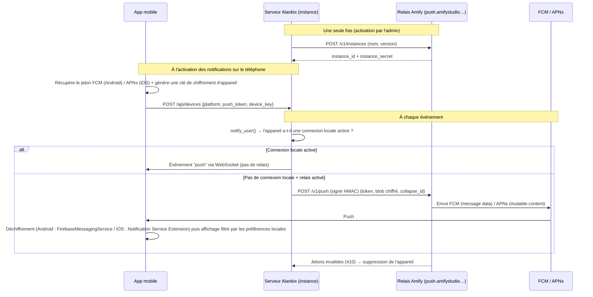

# 📡 Plan : Relais Push Internet (FCM / APNs) — Alanbix

> **Statut** : 💤 Planifié — **non prioritaire**. À démarrer une fois les notifications locales livrées (service Android au premier plan + Local Push Connectivity iOS).
> **Référencé par** : [roadmap_mobile_app.md](roadmap_mobile_app.md) (Phase 7) et le plan mobile « Player-First » v2 (section 4.8).
> **Prérequis administratifs** : D-U-N-S Amify Studio → compte Apple Developer (clé APNs `.p8`) + projet Firebase (FCM).

---

## 1. Pourquoi un relais ?

Les notifications locales (WebSocket natif maintenu par un service Android au premier plan, ou par l'extension iOS `NEAppPushProvider`) couvrent la **LAN 100 % locale**, qui reste le scénario prioritaire et obligatoire. Elles laissent un trou :

| Cas non couvert par le local | Pourquoi |
|---|---|
| **iOS hors du Wi-Fi de la LAN** (joueur en 4G, serveur exposé via Cloudflare Tunnel / reverse proxy) | iOS n'autorise pas de socket en arrière-plan ; Local Push Connectivity ne fonctionne que sur les SSID déclarés. Seul **APNs** peut réveiller l'iPhone. |
| **Android avec économie de batterie agressive** (Xiaomi, Huawei, Samsung…) | Le service au premier plan peut être tué ; **FCM** est prioritaire au niveau système. |
| Joueur qui préfère ne pas garder de connexion permanente | Le push cloud ne consomme presque rien en veille. |

**Contrainte clé** : Alanbix est **auto-hébergé** (une instance par organisateur). Les identifiants FCM/APNs sont liés à l'appli publiée par **Amify Studio** et ne peuvent pas être distribués dans chaque instance. Il faut donc un **relais central opéré par Amify Studio**, auquel les instances qui ont internet transmettent leurs notifications.

---

## 2. Principes

1. **Optionnel et opt-in** : désactivé par défaut ; l'admin de l'instance l'active explicitement. Sans internet, rien ne change.
2. **Le local d'abord** : le serveur n'utilise le relais **que si l'appareil n'a pas de connexion locale active** (socket natif `client=push` absent).
3. **Le relais ne voit pas le contenu** (cible) : contenu chiffré de bout en bout entre l'instance et l'appareil. MVP possible en mode « contenu générique ».
4. **Sans état métier** : le relais ne stocke ni utilisateurs ni messages, seulement les instances enregistrées et des compteurs anti-abus.
5. **Aucun doublon** : même `id` d'événement sur tous les canaux → `apns-collapse-id`, tag de notification Android, dédoublonnage côté appli.

---

## 3. Architecture

---

## 4. Composants & tâches

### 4.1 Service relais (nouveau dépôt ou dossier `relay/`)
- [ ] Petit service conteneurisé **FastAPI + httpx (HTTP/2)** pour APNs, **API FCM HTTP v1** (compte de service Google). Cloudflare Workers à évaluer (vérifier le support HTTP/2 sortant vers APNs).
- [ ] `POST /v1/instances` → émet `instance_id` + `instance_secret`. Enregistrement automatique avec quota faible, révocable.
- [ ] `POST /v1/push` → lot de messages `{platform, token, payload_chiffré, collapse_id, priority, ttl}` ; authentification HMAC-SHA256 (`instance_secret`, horodatage, nonce anti-rejeu).
- [ ] Anti-abus : limite de débit par instance, taille max du blob (APNs : 4 Ko), liste de blocage.
- [ ] Retour des jetons invalides (`410 Unregistered` APNs / `UNREGISTERED` FCM) vers l'instance.
- [ ] Observabilité minimale : compteurs par instance (envoyés / échecs), **aucun contenu journalisé**.
- [ ] Hébergement : petit VPS ou PaaS (quelques €/mois). FCM et APNs sont gratuits.

### 4.2 Serveur Alanbix (instance)
- [ ] Table `devices` (`user_id`, `platform`, `push_token`, `device_key`, `last_seen`, `relay_enabled`) — mutualisée avec le jeton d'appareil longue durée prévu pour les notifications locales.
- [ ] Réglage admin **« Notifications push via internet (relais Amify Studio) »** dans `AdminSettingsTab.svelte` : activation, état d'enregistrement, test d'accès au relais, avertissement de confidentialité.
- [ ] Client relais dans `notify_user()` : repli uniquement si `ws_manager` n'a aucune connexion `client=push` pour cet utilisateur/appareil ; envoi asynchrone par lots, avec nouvelles tentatives.
- [ ] Chiffrement : enveloppe **AES-GCM** du payload `push` (`title`, `body`, `link`, `category`, `id`) avec la `device_key` (clé symétrique générée par l'appli, transmise via l'API authentifiée de l'instance).
- [ ] Mode MVP sans chiffrement de bout en bout : payload générique « 🔔 Nouvelle notification Alanbix » + `id`, le contenu étant récupéré à l'ouverture.

### 4.3 Application mobile
- [ ] Plugin `@capacitor/push-notifications` (+ `google-services.json` Firebase côté Android ; capacité *Push Notifications* côté iOS).
- [ ] Enregistrement du jeton et de la `device_key` sur l'instance (`POST /api/devices`), rafraîchi à chaque changement de jeton ou de serveur ; suppression à la déconnexion.
- [ ] **Android** : `FirebaseMessagingService` natif (messages *data*) → déchiffrement → filtre selon les préférences locales → notification sur le bon canal.
- [ ] **iOS** : **Notification Service Extension** (`mutable-content: 1`) → déchiffrement → filtre → contenu final (préférences dans l'App Group partagé avec l'extension Local Push).
- [ ] Paramètres › Notifications : nouveau choix **« Connexion en arrière-plan »** = `Auto (recommandé)` / `Connexion LAN permanente` / `Push internet uniquement`, plus l'état du relais (disponible ou non sur ce serveur).

### 4.4 Conformité & stores
- [ ] Mise à jour de la politique de confidentialité (sous-traitants Google/Apple, relais Amify, données transmises : jeton + blob chiffré).
- [ ] Google Play *Data Safety* : déclarer Firebase Cloud Messaging.
- [ ] App Store : capacité *Push Notifications*, clé APNs `.p8` stockée dans les secrets du relais (jamais dans le dépôt).

---

## 5. Phasage

| Étape | Contenu | Dépendances |
|---|---|---|
| **R0** | Création du projet Firebase + clé APNs | Comptes développeur (D-U-N-S) |
| **R1** | Relais MVP (instances, push, HMAC, quotas) | R0 |
| **R2** | Intégration serveur (table `devices`, réglage admin, logique de repli) en **mode contenu générique** | R1 + jeton d'appareil (plan local) |
| **R3** | Intégration appli (plugin, enregistrement du jeton, choix « Connexion en arrière-plan ») | R2 |
| **R4** | Chiffrement de bout en bout + Notification Service Extension iOS + `FirebaseMessagingService` Android | R3 |
| **R5** | Supervision, nettoyage des jetons morts, documentation admin (`docs/fr` & `docs/en`) | R4 |

---

## 6. Vérification

1. Instance **sans internet** : le réglage du relais indique « indisponible », aucune erreur, notifications locales intactes.
2. Instance avec internet, iPhone en **4G** (serveur via Cloudflare Tunnel) → MP reçu par APNs, tap → bonne conversation.
3. Téléphone **sur le Wi-Fi LAN avec connexion locale active** → **aucun** appel au relais (vérifié par les compteurs).
4. Aucun doublon quand le téléphone bascule entre Wi-Fi LAN et 4G (même `collapse_id`).
5. Jeton révoqué (appli désinstallée) → `410` → appareil supprimé côté instance.
6. Les journaux du relais ne contiennent aucun contenu en clair (audit).

