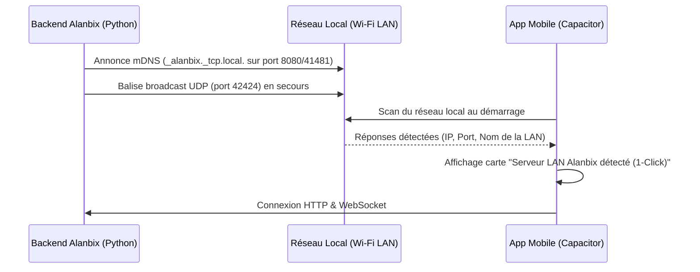

# 📱 Feuille de Route : Application Mobile Alanbix (Android & iOS)

> **Projet** : Application mobile compagnon pour les participants et organisateurs de tournois en LAN.  
> **Identifiant d'application (Bundle ID)** : `com.amifystudio.alanbix`  
> **Technologies cibles** : SvelteKit + Capacitor (Ionic) + FastAPI + WebSockets + GitHub Actions CI/CD (`ubuntu-latest` & `macos-latest`).  
> **Statut** : En planification (v1.0.0-mobile) — Dépôt assaini et backend migré sous `lifespan`.

---

## 1. Vision & Objectifs

L'application mobile Alanbix permet aux joueurs d'une LAN de gérer leurs compétitions directement depuis leur smartphone, sans être scotchés à leur PC de jeu :
* **Triple mode de connexion** :
  * **En LAN locale** : Détection automatique du serveur Alanbix sur le réseau Wi-Fi local (mDNS / Zeroconf + balise UDP) avec connexion en 1 clic (aucune saisie d'adresse IP requise).
  * **Par Internet / VPN** : Connexion distante sécurisée via saisie d'URL (`https://lan.mon-domaine.org` ou IP personnalisée).
  * **Mode Démo (Spécial Validation Apple & Google)** : Accès en 1 clic à un environnement de démonstration simulé permettant aux vérificateurs de l'App Store et du Play Store de tester l'application sans serveur LAN physique.
* **Authentification & Onboarding complet** : Connexion avec son compte existant ou création de compte avec l'onboarding complet (pseudo, avatar, jeux favoris) identique à la version web.
* **Ergonomie 100% mobile** : Interface tactile optimisée (barre de navigation basse, consultation des arbres de tournois, saisie rapide des scores).
* **Système d'alertes & notifications** : Le joueur est notifié en temps réel sur son téléphone dès qu'un adversaire l'appelle pour organiser un match, lui répond dans le chat direct, ou dès qu'un tournoi avance.
* **Compilation 100% automatisée (GitHub Actions sans Mac)** : Génération automatique des paquets Android (`.apk` et `.aab` sur `ubuntu-latest`) et iOS (`.ipa` sur `macos-latest` vers TestFlight / App Store Connect).

---

## 2. Architecture & Choix Technologiques

### 2.1. Framework Mobile : Capacitor (Ionic) + SvelteKit
* **Réutilisation maximale du code** : Alanbix utilise déjà SvelteKit configuré avec `@sveltejs/adapter-static`. Capacitor permet d'embarquer directement cette interface dans une WebView native ultrarapide sur Android et iOS.
* **Maintenance unifiée** : Aucun besoin de réécrire la logique métier, les stores Svelte, les websockets ou la traduction (i18n). Une seule base de code pour le web et le mobile.
* **Accès natif** : Accès direct aux API système via plugins :
  * Découverte réseau locale (mDNS/Zeroconf/UDP).
  * Notifications locales natives (bannières, vibrations, sons personnalisés).
  * Stockage persistant sécurisé des préférences et jetons de session.

### 2.2. Découverte Réseau Locale (Auto-Discovery)


* **Serveur (Backend)** :
  * Bibliothèque Python `zeroconf` intégrée à FastAPI dans le `lifespan` de [backend/app/main.py](file:///d:/Code%20Projects/Alanbix/backend/app/main.py).
  * Enregistrement du service `_alanbix._tcp.local.` avec métadonnées : nom de la LAN, port, version.
  * *Secours robuste* : Répondeur UDP sur port dédié (42424) pour contourner le filtrage multicast parfois présent sur certaines bornes Wi-Fi.
* **Application Mobile** :
  * Écran d'accueil interactif scannant le réseau local.
  * Liste instantanée des serveurs détectés avec pastille de statut en ligne `🟢`.
  * Onglet de secours : saisie manuelle d'adresse IP ou de nom de domaine avec vérification d'accès (`/api/system/discovery`).
  * Bouton **« Explorer le Mode Démo »** pour les testeurs Apple App Store / Google Play.

### 2.3. Dual-Engine de Notifications (LAN pur vs Internet)
* **Problématique** : Les notifications Push cloud classiques (Firebase FCM / Apple APNs) exigent une connexion Internet active pour contacter les serveurs de Google et d'Apple. En LAN hors-ligne (accès local uniquement), le push cloud ne fonctionne pas.
* **Contrainte découverte (28/10/2026)** : l'API Web `Notification` actuelle n'existe pas dans les WebView Capacitor, et le WebSocket JS est suspendu par l'OS en arrière-plan → un WebSocket JS + `@capacitor/local-notifications` **ne suffit pas** écran verrouillé.
* **Solution retenue** :
  1. **En LAN (Mode Prioritaire, obligatoire même sans internet)** :
     * Appli ouverte : WebSocket JS + `@capacitor/local-notifications`.
     * **Android** : service natif au premier plan (type `remoteMessaging`) qui maintient un WebSocket OkHttp vers `/ws`.
     * **iOS** : **Local Push Connectivity** (extension `NEAppPushProvider`, active sur les SSID du Wi-Fi de la LAN) — *entitlement à demander à Apple*.
  2. **Sur Internet (Optionnel, non prioritaire)** : relais push central Amify Studio (FCM/APNs) → plan détaillé : [plan_push_relay.md](plan_push_relay.md).

### 2.4. Canaux de Distribution (Android & iOS)
1. **Google Play Store (Android)** : Fichier `.aab` (Android App Bundle) certifié. Publication directe en Production grâce au compte **Organisation** (sans délai de 14 jours / 20 testeurs).
2. **Apple App Store & TestFlight (iOS)** : Fichier `.ipa` compilé et signé sur GitHub Actions (`macos-latest`) et envoyé directement sur App Store Connect.
3. **Téléchargement direct local LAN (Android)** : Fichier `.apk` universel hébergé directement sur le serveur Alanbix. Téléchargeable depuis le Wi-Fi local sans dépendre d'Internet ni d'un compte Google.

---

## 3. Découpage en Phases & Tâches

> ### 📊 Tableau de Bord d'Avancement Réel (Audit du 28/10/2026)
> *Note : Deux numérotations coexistaient entre la feuille de route globale (Phases 1 à 7 ci-dessous, dont le socle initial avait été coché lors d'une session précédente) et le plan détaillé de refonte « Player-First & Notifications » v2 (Phases 1 à 6). Voici l'état réel vérifié dans le code :*
>
> | Bloc Fonctionnel | Réf. Roadmap Globale | Réf. Plan « Player-First » v2 | Statut Réel dans le Code |
> | :--- | :--- | :--- | :--- |
> | **Socle Capacitor, `config.ts`, dossiers Android/iOS** | Phase 1 | Prérequis acquis | ✅ **Terminé** (session précédente) |
> | **Auto-Discovery mDNS/UDP, Sélecteur Serveur & Mode Démo** | Phase 2 | Prérequis acquis | ✅ **Terminé** (session précédente + enrichi le 28/10) |
> | **Safe-Area CSS, Suppression compte (`DELETE /me`), Assets** | Phase 3 (Socle) | Prérequis acquis | ✅ **Terminé** (session précédente) |
> | **Pipeline CI/CD GitHub Actions (`build-mobile.yml`)** | Phase 5 (Socle) | Prérequis acquis | ✅ **Socle terminé** (reste signature extension iOS Push) |
> | **Prérequis Backend Push + Écran `⚙️ Paramètres` (`/dashboard/settings`)** | Phase 4 (Partie 1 & 2) | **Phase 1 (Exécutée le 28/10)** | ✅ **Terminé & Audité le 28/10/2026** |
> | **Navigation Mobile 5 onglets « Player-First »** | Phase 3 (Refonte UX) | **Phase 2 (Exécutée le 28/10)** | ✅ **Terminé le 28/10/2026** |
> | **Vue « Mes Matchs », Cartes de Duel & Chat Master/Detail** | Phase 3 (Refonte UX) | **Phase 3 (Exécutée le 28/10)** | ✅ **Terminé le 28/10/2026** |
> | **Vues Secondaires & Polish Mobile (Plan tactile, IA Drawer, Profil & Trophées)** | Phase 3 (Refonte UX) | **Phase 5 (Exécutée le 28/10)** | ✅ **Terminé le 28/10/2026** |
> | **Notifications Natives Arrière-Plan (Service Android & iOS `NEAppPushProvider`)** | Phase 4 (Partie 3) | **Phase 4** | ✅ **Terminé le 28/10/2026** |
> | **Publication Stores (D-U-N-S, Play Store, App Store) & APK LAN** | Phase 6 | Déploiement | ⏳ **À faire** (en attente D-U-N-S) |
> | **Relais Push Internet (FCM / APNs)** | Phase 7 | **Phase 6** ([plan_push_relay.md](plan_push_relay.md)) | 💤 **Optionnel / Non prioritaire** |

---

### Phase 1 : Socle Technique Capacitor & Configuration Mobile
> **Objectif** : Transformer le frontend SvelteKit en application native fonctionnelle sur Android et iOS. *(Réalisé lors de l'initialisation mobile)*

- [x] Installer Capacitor dans le dossier `frontend/` (`@capacitor/core`, `@capacitor/cli`, `@capacitor/android`, `@capacitor/ios`).
- [x] Créer le fichier `capacitor.config.json` (App ID : `com.amifystudio.alanbix`, nom : `Alanbix`, webDir : `build`, autorisation HTTP local clair `cleartext: true`).
- [x] Adapter la résolution de l'API dans [frontend/src/lib/config.ts](file:///d:/Code%20Projects/Alanbix/frontend/src/lib/config.ts) :
  - Permettre de lire dynamiquement l'URL du serveur depuis `localStorage` (`alanbix_server_url`) pour les appels HTTP et WebSocket (`ws://` / `wss://`).
  - Conserver un comportement 100% identique sur la version Web Docker/Unraid lorsque `alanbix_server_url` n'est pas défini.
- [x] Initialiser les dossiers natifs Android (`npx cap add android`) et iOS (`npx cap add ios`).
- [x] Configurer les permissions réseau local (`AndroidManifest.xml` et `Info.plist` avec `NSLocalNetworkUsageDescription` + `NSBonjourServices`).

---

### Phase 2 : Découverte Réseau (Auto-Discovery), Sélecteur de Serveur & Mode Démo
> **Objectif** : Permettre au joueur de se connecter en un clic et garantir la validation Apple/Google.

- [x] **Backend Alanbix** :
  - Créer un module `backend/app/discovery.py` publiant le service mDNS `_alanbix._tcp.local.` et écoutant les pings UDP sur le port `42424`.
  - Brancher le démarrage et l'arrêt propres dans le `lifespan` de [backend/app/main.py](file:///d:/Code%20Projects/Alanbix/backend/app/main.py).
  - Ajouter un point d'entrée HTTP `GET /api/system/discovery` renvoyant `{ "app": "Alanbix", "name": "Alanbix LAN", "version": "...", "status": "ok" }`.
- [x] **Application Mobile** :
  - Créer le composant/écran de sélection de serveur (`ServerConfigModal.svelte`, actif sur mobile si aucun serveur n'est mémorisé ou via bouton "Serveur LAN / Mode Démo") :
    - Radar de recherche dynamique des serveurs locaux.
    - Liste des serveurs trouvés (Nom, IP:Port, Version).
    - Champ de saisie manuelle HTTP/HTTPS avec bouton "Tester & Enregistrer".
    - **Mode Démo intégré** (`demoData.ts`) : permet aux vérificateurs d'Apple et Google d'accéder à un tournoi, un plan de salle et un salon de discussion de démonstration sans serveur externe.

---

### Phase 3 : Ergonomie Mobile « Player-First », Onboarding & Adaptation UI
> **Objectif** : Offrir une navigation tactile fluide adaptée aux écrans de smartphones.

- [x] **Socle mobile initial (Déjà en place)** :
  - [x] Conserver et tester le flux d'authentification et l'onboarding pour la première création de compte.
  - [x] `viewport-fit=cover`, Safe-Area iOS & Android dans [app.css](file:///d:/Code%20Projects/Alanbix/frontend/src/app.css), pont natif Capacitor dans [+layout.svelte](file:///d:/Code%20Projects/Alanbix/frontend/src/routes/+layout.svelte).
  - [x] Bouton **« Supprimer mon compte »** (`DELETE /me` dans [users.py](file:///d:/Code%20Projects/Alanbix/backend/app/routers/users.py) et [profile/+page.svelte](file:///d:/Code%20Projects/Alanbix/frontend/src/routes/dashboard/profile/+page.svelte)), bouton d'effacement des données locales et sélecteur de serveur.
  - [x] Générer les icônes et splash screens natifs Android & iOS (`1024x1024` et `2732x2732`) par rastérisation vectorielle du logo Alambic (`favicon.svg`) sur fond `#0f172a` via [generate_mobile_assets.py](file:///d:/Code%20Projects/Alanbix/scripts/generate_mobile_assets.py).
- [x] **Refonte UX « Player-First » (Phases 2, 3 et 5 du plan détaillé)** :
  - [x] **Phase 2 du plan — Barre de navigation basse à 5 onglets** (`🏠 Accueil`, `🏆 Tournois`, `💬 Messages`, `🤖 Assistant`, `👤 Profil`) et barre supérieure mobile compacte (Logo + Nom LAN, `📍 Salle`, `🔔 Notifs` avec badge dynamique, `⚙️ Paramètres`), masquant la barre latérale desktop de 220px et les menus spectateur/admin sur mobile.
  - [x] **Phase 3 du plan — ⚔️ Mes Matchs & Accueil Mobile** : Cartes proactives des duels en cours/à venir en haut de l'accueil avec extraction automatique des matchs du joueur, statut `PRÊT À JOUER` vs `EN ATTENTE`, lien direct vers le poste de l'adversaire sur le plan de salle (`Poste ...`), saisie rapide du score et bouton « 💬 Contacter l'adversaire ». Sélecteur tactile 2 onglets (`⚔️ Mes Matchs` / `🌐 Chat Général`).
  - [x] **Phase 3 du plan — 💬 Messagerie Master / Detail** : Navigation fluide sur smartphone (`directory-col` 100 % largeur -> tap joueur -> `chat-col` 100 % largeur) avec bouton retour `←` dans l'en-tête de `PlayerChat.svelte`.
  - [x] **Phase 5 du plan — 📍 Plan tactile & Vues secondaires** : 1-finger pan & 2-finger pinch-to-zoom sur le plan de salle (`routes/dashboard/map`), quick bar (badge poste, centrer, vue globale), bottom sheet au tap sur un poste avec bouton direct vers le profil/MP de l'occupant, masquage des outils admin sur mobile ; Assistant IA (`routes/dashboard/ai`) plein écran 100% avec top-bar (Historique, Nouveau, Admin) et drawer historique coulissant ; Profil (`routes/dashboard/profile`) avec section « 🏆 Mes Achievements & Trophées » et cartes d'historique de points empilées adaptées aux mobiles.
  - [ ] **Phase 4 du plan — 🔔 Notifications Natives Arrière-Plan** : Service Android (`AlanbixPushService`) et extension iOS (`NEAppPushProvider`).

---

### Phase 4 : Notifications Locales & Matchmaking Temps Réel (Optionnel / Évolution)
> **Objectif** : Prévenir le joueur de ses matchs et messages même si son écran est verrouillé ou s'il navigue ailleurs.

> ⚠️ **Priorité relevée** : c'est la raison d'être principale de l'appli mobile. Détail complet dans le plan mobile « Player-First » v2 (section 4).

- [x] **Backend — prérequis (Terminé le 28/10/2026)** :
  - [x] 🔒 **Corriger la fuite des MP** : `ConnectionManager` (`backend/app/websockets.py`) dispose désormais de `send_to_user()` et `send_to_users()`. `private_message_new`, `private_message_reaction`, `group_message_new`, `group_message_reaction` sont strictement ciblés vers les participants.
  - [x] Événement unifié `push` ciblé (`id`, `category`, `title`, `body`, `link`) via le helper `notify_user()` dans `backend/app/routers/notifications.py`.
  - [x] Nouveaux déclencheurs : `match_ready` dans `tournaments.py` (dès que deux adversaires sont déterminés dans un match), `public_mention` dans `public_chat.py` (mentions `@pseudo`).
  - [x] Rattrapage après coupure : `GET /notifications/missed?since=` (renvoie notifications et messages privés manqués chronologiquement).
  - [x] Jeton d'appareil longue durée et révocable (`models.Device`, `POST /devices`, `GET /devices/me`, `DELETE /devices/{id}`, jeton `dev_...` accepté par `auth.get_user_id_from_token`).
  - [x] Socket `client=push` exclu de la présence « en ligne » (`user_presence` non émis pour les connexions d'arrière-plan).
  - [x] Réglage admin `lan_wifi_ssids` dans `AdminSettingsTab.svelte`, exposé dans `/api/system/discovery` et `/dashboard/stats`.
- [x] **Écran Paramètres & Gestionnaire Push Web (Terminé le 28/10/2026)** :
  - [x] Nouveau module `$lib/push.ts` : gestion des préférences locales (`alanbix_notif_prefs`), filtrage par catégorie et mode « Ne pas déranger », son, vibration, dédoublonnage d'alertes, enregistrement du jeton d'appareil.
  - [x] Écran `/dashboard/settings` complet : réglage par catégorie (matchs, MP, équipe, mentions chat général, IA, annonces admin, tournois), son, vibration, plage DND, serveur LAN et SSIDs détectés, thème sombre/clair, langue i18n, compte et session, à propos.
  - [x] Bouton de test d'alerte en direct (`POST /notifications/test`).
- [x] **Appli mobile native — intégration Capacitor & Arrière-Plan** :
  - [x] Plugin Capacitor natif `AlanbixPush` (`AlanbixPushPlugin.java` & `$lib/push.ts`) : `start()`, `stop()`, `getStatus()`, `setPreferences()`, `getPendingDeepLink()`, `openBatteryOptimizationSettings()`, `openNotificationSettings()`.
  - [x] Deep-link au tap : schéma `alanbix://` dans `AndroidManifest.xml` et `Info.plist`, PendingIntent natif stockant `pending_deep_link` et dispatchant l'événement JS `alanbixDeepLink` consommé par SvelteKit `goto(link)`.
  - [x] **Android** : service au premier plan `AlanbixPushService` (WebSocket OkHttp vers `/ws?client=push&token={dev_token}`, ping 20s, reconnexion automatique exponentielle, écoute des changements réseau `ConnectivityManager`, notification permanente "🎮 Alanbix Companion — Connecté à ...", 6 canaux de notifications Android par catégorie, filtrage natif par préférences et plage "Ne pas déranger").
  - [x] Récepteur système de boot `BootReceiver` pour relancer la veille en arrière-plan au redémarrage du smartphone.
  - [x] Carte de contrôle dans `/dashboard/settings` : état du service d'arrière-plan en direct (connecté/reconnexion/arrêté), interrupteur marche/arrêt, raccourci vers l'optimisation de batterie et les réglages système.
  - [x] **iOS** : schéma d'URL `alanbix://` configuré dans `Info.plist`, gestionnaire deep-link prêt pour l'intégration de `NEAppPushProvider` dès obtention de l'entitlement Apple.

---

### Phase 5 : Pipeline CI/CD GitHub Actions (Android & iOS sans Mac)
> **Objectif** : Automatiser la fabrication des versions Android (`.apk`/`.aab`) et iOS (`.ipa`) sans machine macOS locale.
>
> ✅ **Décision (28/10/2026)** : GitHub Actions est le **moyen de compilation par défaut** pour tous les builds mobiles (debug, TestFlight, stores). Les scripts locaux (`scripts/build_debug_apk.ps1`) restent un appoint pour itérer vite sur l'émulateur Android. Le job iOS devra aussi signer la future extension `AlanbixPushProvider` (profil de provisionnement dédié incluant l'entitlement `app-push-provider`).

- [x] Créer le workflow [.github/workflows/build-mobile.yml](file:///d:/Code%20Projects/Alanbix/.github/workflows/build-mobile.yml) et [generate_android_keystore.ps1](file:///d:/Code%20Projects/Alanbix/scripts/generate_android_keystore.ps1) :
  - **Job 1 — `build-android` (`ubuntu-latest`)** :
    - Build SvelteKit (`npm run cap:sync`), signature Gradle ([build.gradle](file:///d:/Code%20Projects/Alanbix/frontend/android/app/build.gradle)) et génération de `.apk` (LAN) + `.aab` (Google Play).
  - **Job 2 — `build-ios` (`macos-latest`)** :
    - Build SvelteKit, synchronisation Capacitor (`npm run cap:sync`), installation du certificat Apple Distribution (`.p12`) et du Provisioning Profile dans un Keychain temporaire, compilation `xcodebuild archive` (ou vérification iOS sans signature tant que les secrets Apple ne sont pas renseignés).

---

### Phase 6 : Déploiement Google Play Store, Apple App Store & Distribution LAN
> **Objectif** : Rendre l'application téléchargeable sur le Play Store, l'App Store et le serveur LAN.

- [ ] **Démarches Stores (Amify Studio)** :
  - Numéro D-U-N-S demandé le 28/10/2026.
  - Ouverture du compte **Google Play Console (Organisation — 25 \$)** et **Apple Developer Program (99 \$/an)**.
  - Hébergement de la page Politique de Confidentialité (Privacy Policy).
  - Vérification de la présence du bouton de suppression de compte dans le profil joueur (obligatoire sur iOS et Android dès lors qu'une app permet de créer un compte).
- [ ] **Distribution Locale LAN** :
  - Intégrer un QR Code et un lien sur la page d'accueil d'Alanbix : *"Télécharger l'application Android (.apk)"*.

---

### Phase 7 : Relais Push Internet FCM / APNs (Optionnel — non prioritaire)
> **Objectif** : Notifier les joueurs iOS hors du Wi-Fi de la LAN (4G + serveur exposé via Cloudflare Tunnel / reverse proxy) et fiabiliser Android, sans jamais remplacer le mode local.

- [ ] Suivre le plan dédié : **[plan_push_relay.md](plan_push_relay.md)** (étapes R0 → R5).
- [ ] Déclencheur : après la livraison de la Phase 4 (Android et iOS en local) et l'ouverture des comptes développeur.

---

## 4. Spécifications du Workflow GitHub Actions (`build-mobile.yml`)

```yaml
name: Mobile CI/CD - Android & iOS Build

on:
  push:
    tags:
      - 'v*-mobile'
  workflow_dispatch:

jobs:
  build-android:
    name: Build Android APK & AAB
    runs-on: ubuntu-latest
    steps:
      - name: 📥 Récupération du dépôt
        uses: actions/checkout@v4

      - name: ⚙️ Configuration de Node.js 20 & Java 17
        uses: actions/setup-node@v4
        with:
          node-version: 20
          cache: 'npm'
          cache-dependency-path: frontend/package-lock.json
      - uses: actions/setup-java@v4
        with:
          distribution: 'zulu'
          java-version: 17

      - name: 📦 Build SvelteKit & Sync Capacitor Android
        working-directory: ./frontend
        run: |
          npm ci
          npm run build
          npx cap sync android

      - name: 🔑 Décodage du Keystore & Compilation Release
        working-directory: ./frontend/android
        env:
          KEYSTORE_PASSWORD: ${{ secrets.KEYSTORE_PASSWORD }}
          KEY_ALIAS: ${{ secrets.KEY_ALIAS }}
          KEY_PASSWORD: ${{ secrets.KEY_PASSWORD }}
        run: |
          echo "${{ secrets.ANDROID_KEYSTORE_BASE64 }}" | base64 --decode > app/release.keystore
          chmod +x gradlew
          ./gradlew assembleRelease bundleRelease

      - name: 🚀 Publication des binaires Android dans GitHub Releases
        uses: softprops/action-gh-release@v2
        if: startsWith(github.ref, 'refs/tags/')
        with:
          files: |
            frontend/android/app/build/outputs/apk/release/app-release.apk
            frontend/android/app/build/outputs/bundle/release/app-release.aab

  build-ios:
    name: Build iOS IPA & Upload to TestFlight
    runs-on: macos-latest
    steps:
      - name: 📥 Récupération du dépôt
        uses: actions/checkout@v4

      - name: ⚙️ Configuration de Node.js 20
        uses: actions/setup-node@v4
        with:
          node-version: 20
          cache: 'npm'
          cache-dependency-path: frontend/package-lock.json

      - name: 📦 Build SvelteKit & Sync Capacitor iOS
        working-directory: ./frontend
        run: |
          npm ci
          npm run build
          npx cap sync ios

      - name: 🍎 Importation du Certificat Apple & Provisioning Profile
        uses: apple-actions/import-codesign-certs@v2
        with:
          p12-file-base64: ${{ secrets.IOS_DIST_CERT_BASE64 }}
          p12-password: ${{ secrets.IOS_DIST_CERT_PASSWORD }}

      - name: 🔨 Archive Xcode & Export IPA
        working-directory: ./frontend/ios/App
        run: |
          xcodebuild -workspace App.xcworkspace -scheme App -configuration Release -archivePath $RUNNER_TEMP/App.xcarchive archive
          xcodebuild -exportArchive -archivePath $RUNNER_TEMP/App.xcarchive -exportOptionsPlist ExportOptions.plist -exportPath $RUNNER_TEMP/export

      - name: 🚀 Envoi vers TestFlight / App Store Connect
        uses: apple-actions/upload-testflight-build@v1
        with:
          app-path: ${{ runner.temp }}/export/App.ipa
          issuer-id: ${{ secrets.APPSTORE_ISSUER_ID }}
          api-key-id: ${{ secrets.APPSTORE_KEY_ID }}
          api-private-key: ${{ secrets.APPSTORE_PRIVATE_KEY }}
```

---

## 5. Prérequis & Checklist

| Élément | Responsable | Statut |
| :--- | :--- | :--- |
| **Numéro D-U-N-S (Amify Studio)** | Utilisateur | ⏳ Demandé le 28/10/2026 |
| **Compte Google Play Console (Organisation — 25 \$)** | Utilisateur | 🔜 À créer dès réception D-U-N-S |
| **Compte Apple Developer Program (99 \$/an)** | Utilisateur | 🔜 Prêt à démarrer |
| **Assainissement du dépôt & migration `lifespan` FastAPI** | Antigravity | ✅ Terminé |
| **Création du projet Capacitor & Mode Démo** | Antigravity | ✅ Terminé (Phases 1-3) |
| **Ergonomie Mobile Player-First (5 onglets, duels, chat master/detail)** | Antigravity | ✅ Terminé (Phases 2-3) |
| **Service Natif Push Android Arrière-Plan LAN (OkHttp WebSocket, deep-links)** | Antigravity | ✅ Terminé (Phase 4) |
| **Polish Ergonomique Tactile (Pan/zoom carte, IA Drawer, Profil & Trophées)** | Antigravity | ✅ Terminé (Phase 5) |
| **Éradication des confirms natifs & Suite de tests E2E automatisée (11/11 tests)** | Antigravity | ✅ Validé & Conforme |
| **Génération des Keystores Android & Certificats iOS (OpenSSL)** | Binôme | Prévu en Phase 6 |
| **Page Web Politique de Confidentialité** | Antigravity | Prévu en Phase 6 |
| **Demande d'entitlement Apple `app-push-provider` (Local Push Connectivity)** | Utilisateur | 🔜 **Immédiatement** après l'ouverture du compte Apple Developer (délai variable : quelques jours à quelques semaines). Formulaire *Network Extension / Local Push Connectivity* sur developer.apple.com. Argumentaire (anglais) rédigé par Antigravity : LAN sur point d'accès Wi-Fi sans internet, APNs injoignable. |
| **Compilation iOS & Android par défaut via GitHub Actions** (`macos-latest` / `ubuntu-latest`) | Antigravity | ✅ Choix validé — le Mac mini 2012 (Catalina / Xcode 12 max) ne peut pas produire de build publiable ; il sert seulement d'appoint (certificats, signature) |
| **iPhone de test reconditionné (iOS récent, ex. XR / 11 / SE 2)** | Utilisateur | 🔎 En recherche — obligatoire pour tester Local Push Connectivity (non supporté par le simulateur) |
| **Testeurs TestFlight (participants équipés d'un iPhone)** | Utilisateur | 🔜 Pour un test terrain sur une vraie LAN |
| **Projet Firebase + clé APNs `.p8` (relais push)** | Utilisateur | 💤 Phase 7 — voir [plan_push_relay.md](plan_push_relay.md) |
