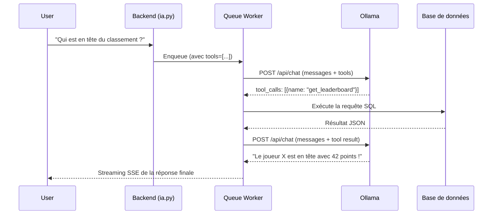

# IA Tool Calling — Accès aux données LAN en temps réel

L'IA Alanbix pourra consulter les données live de la LAN (tournois, scores, classement) grâce au mécanisme de **tool calls** d'Ollama. Le modèle ne va pas exécuter de code — il demande une fonction, le backend l'exécute et renvoie le résultat dans la conversation.

## Flux Technique



## Tools Implémentés (16 fonctions — état au 2026-07-05)

| Tool | Description | Paramètres |
|------|-------------|------------|
| `get_tournaments` | Liste des tournois avec statut, jeu, nombre de participants | `status` (optionnel) |
| `get_tournament_standings` | Classement d'un tournoi spécifique | `tournament_name` |
| `get_leaderboard` | Classement général de la LAN (top joueurs + top équipes) | — |
| `get_player_info` | Infos d'un joueur : points, équipe, rang, participations | `username` (optionnel) |
| `get_my_matches` | Matchs en cours et à venir d'un joueur | `username` (optionnel) |
| `get_games` | Liste des jeux disponibles dans la bibliothèque | `search` (optionnel) |
| `get_game_rules` | Règles complètes non tronquées d'un jeu | `game_name` |
| `get_event_info` | Informations générales de l'événement LAN | — |
| `get_notifications` | Dernières notifications du joueur | `unread_only` (optionnel) |
| `get_current_datetime` | Date et heure actuelles (Europe/Paris) | — |
| `get_player_seat` | Place assignée d'un joueur dans la salle | `username` (optionnel) |
| `ping_host` | Ping ICMP réel vers une machine | `host`, `count` (optionnel) |
| `traceroute_host` | Traceroute réseau vers un hôte | `host` |
| `dns_lookup` | Résolution DNS d'un nom de domaine | `domain` |
| `check_server_health` | Santé du serveur (CPU, RAM, disque) | — |
| `scan_local_network` | Scanner le réseau local (table ARP) | — |
| `block_user_from_ia` | Bloquer un joueur abusif (auto-modération) | `reason` |

> **Outils futurs suggérés** : voir [`docs/archive/ia_improvements.md`](docs/archive/ia_improvements.md) (historique) pour la liste complète des 14 améliorations proposées.

## Proposed Changes

### Backend — Définition et exécution des tools

---

#### [NEW] [ia_tools.py](file:///d:/Code%20Projects/Alanbix/backend/app/ia_tools.py)

Nouveau module contenant :
1. **`TOOL_DEFINITIONS`** — liste des tools au format Ollama JSON Schema
2. **`execute_tool(name, arguments, db)`** — dispatch et exécution des fonctions avec accès DB
3. Chaque tool retourne un résultat JSON compact (limité en taille pour ne pas exploser le contexte)

```python
TOOL_DEFINITIONS = [
    {
        "type": "function",
        "function": {
            "name": "get_tournaments",
            "description": "Obtenir la liste des tournois de la LAN avec leur statut, jeu et nombre de participants",
            "parameters": {
                "type": "object",
                "properties": {
                    "status": {
                        "type": "string",
                        "description": "Filtrer par statut: OPEN, RUNNING, DONE, CLOSED (optionnel, tous par défaut)",
                        "enum": ["OPEN", "RUNNING", "DONE", "CLOSED"]
                    }
                },
                "required": []
            }
        }
    },
    ...
]
```

---

#### [MODIFY] [ia_queue.py](file:///d:/Code%20Projects/Alanbix/backend/app/ia_queue.py)

Modifier `_process_chat` pour gérer le cycle tool-calling :

1. Premier appel Ollama avec `tools=TOOL_DEFINITIONS` dans `req_data`
2. Si la réponse contient `tool_calls` (au lieu de `content`) :
   - Exécuter chaque tool via `execute_tool()`
   - Ajouter les messages `assistant` (tool_calls) + `tool` (résultats) à l'historique
   - Relancer l'appel Ollama **sans streaming** pour obtenir la réponse finale
   - Streamer la réponse finale au client
3. Si pas de tool_calls → comportement inchangé (streaming normal)

> Le worker gère les tool calls en interne — le frontend ne voit que le résultat final en streaming.

---

#### [MODIFY] [ia.py](file:///d:/Code%20Projects/Alanbix/backend/app/routers/ia.py)

Ajouter `tools=TOOL_DEFINITIONS` dans le `req_data` envoyé au worker (lignes ~497-502).

---

### Aucune modification frontend nécessaire

Le tool calling est entièrement transparent pour le frontend. Le worker exécute les outils et produit la réponse finale en streaming comme d'habitude.

## Limites et Sécurité

- Les tools sont **lecture seule** — aucune modification de données
- Les résultats sont **tronqués** (max 20 entrées pour les standings, max 10 pour le leaderboard)
- Max **3 cycles** de tool calls par requête pour éviter les boucles infinies
- Le cycle tool call ajoute ~2-5s de latence (un appel Ollama supplémentaire non-streaming)

## Verification Plan

### Tests manuels
- "Quels tournois sont en cours ?" → doit lister les tournois RUNNING
- "Qui est premier au classement ?" → doit retourner le top du leaderboard
- "Quels sont les scores du tournoi X ?" → doit retourner le standings du tournoi
- "Quel temps fait-il ?" → doit répondre normalement sans tool call
