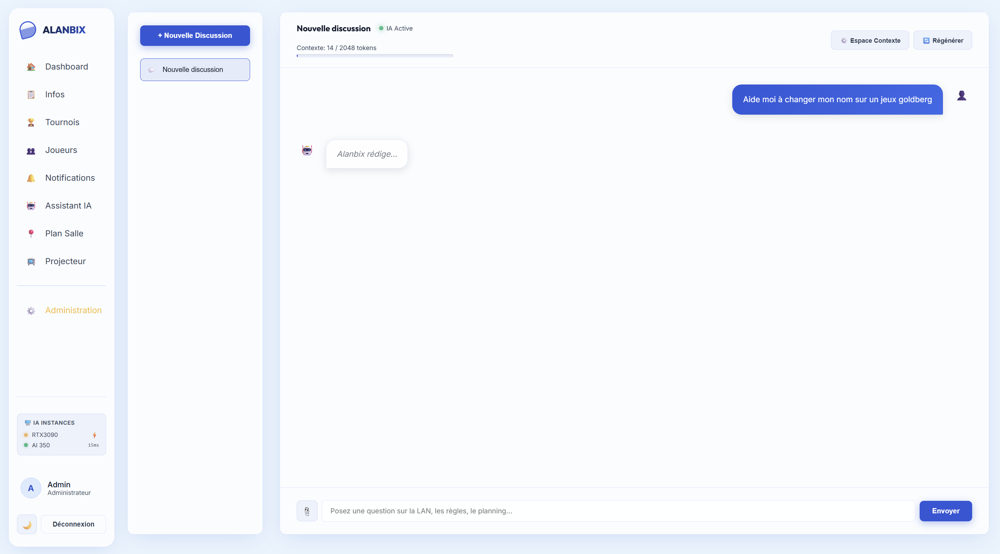
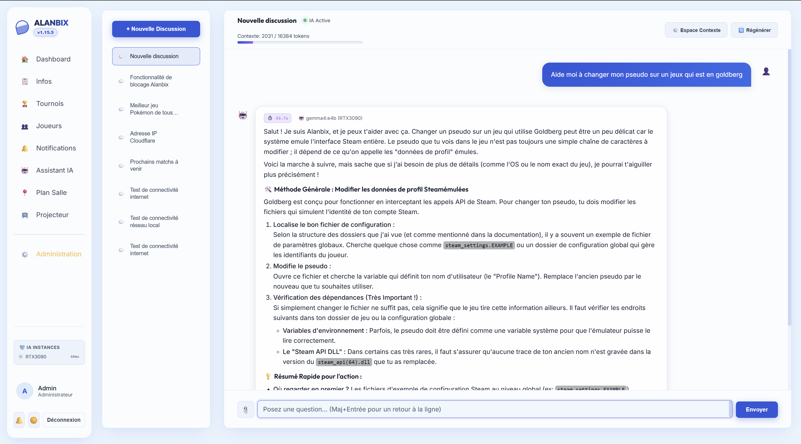
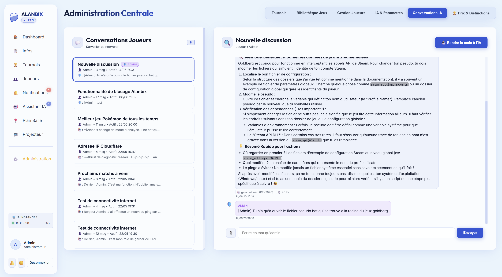

# 🤖 AI Assistant & Ollama

Alanbix integrates a sophisticated self-hosted AI assistant based on Ollama, designed to run entirely offline. It responds to user queries using a native RAG (Retrieval-Augmented Generation) pipeline and features advanced context management capabilities.

---

## ⚙️ AI Flow Architecture (RAG & SSE)

### Streaming Responses (Server-Sent Events)
* To avoid frustrating waiting times for players, the FastAPI backend streams tokens generated by the LLM in real-time via Server-Sent Events (SSE).
* The SvelteKit frontend consumes this stream using a `TextDecoder` for smooth word-by-word rendering.

### Knowledge base (hybrid RAG)
Before each answer, Alanbix looks in the knowledge base for the entries that answer the question and puts them in the AI's instructions. No vector database to install: everything runs in memory, which is plenty for a few hundred entries.
1. **Two searches, combined**:
   * **By keywords** (BM25 score, the one of classic search engines): always available, finds names and exact terms ("Goldberg", "WC"). Accents, small words and simple plurals are ignored, and an entry must hold a good share of the question's words.
   * **By meaning** (embeddings and cosine similarity): finds rephrasings ("toilet door" / "WC lock") and questions asked in another language, when an embedding model answers. An entry is kept only above a similarity threshold: adjustable for an external model (0.65 by default), specific to the built-in model (0.35).
   * Both rankings are merged (Reciprocal Rank Fusion) and the best 3 entries are passed on.
2. **The built-in model**: a button in the guided setup and in the "Knowledge base" section downloads `paraphrase-multilingual-MiniLM-L12-v2` once (135 MB, Apache 2.0 licence, verified download) into the data folder, where it survives updates. It runs on the processor with ONNX Runtime, with no graphics card or Internet, and takes about 400 MB of memory from the first search. Entries are re-indexed automatically. In "Automatic" mode it is used as soon as it is installed; an external model picked in the settings still wins.
3. **Without an embedding model**, the keyword search works alone. The embedding server is then asked again only every 5 minutes, so it does not slow every message down.
4. **Indexing**: each entry records the embedding model that indexed it. Vectors of two different models are never compared: after a model change, the banner of the "Knowledge base" section shows how many entries need re-indexing, with a **Re-index** button. The banner also says whether the meaning search works, and if not, why.
5. **Context isolation**: the AI switches between the general LAN context (schedule, WiFi, rules) and the context of a specific game.
6. **Follow-ups**: the search combines the question with the player's previous message, so a follow-up ("and how do I do that?") still finds its topic. `@Alanbix` in the public chat uses the same search.

### System prompt construction (layers)
Each request sends the model a single system message, built in this order:
1. **Personality**: the admin-editable "Main instructions" text (identity, tone, style).
2. **Operating rules**: fixed and translated, they cannot be erased from the admin (never invent data, never name internal tools, diagnosis method, when and how to alert an admin, moderation).
3. **App guide**: a map of the site's pages, to guide players. Editable by the admin, with a "Restore the default text" button.
4. **Live context**: date and time, event, player's username, team, seat and role.
5. **Admin-call limits, compressed context and relevant knowledge**, depending on the conversation.
6. **Language**: the assistant answers in the player's interface language; rules, guide and context follow it.

The AI tab of the administration offers a **final prompt preview** (with its estimated size in tokens) to see exactly what the model receives.

---

## 🗄️ AI Context Management & Compression

Local language models have a physical limit on the number of words they can analyze at the same time (the context window).

### The Auto-Compression Mechanism (G-40)
Before each request, the backend estimates the number of tokens in the conversation (empirical rule: 1 word = ~1.3 tokens).
* If the token volume exceeds **90%** of the model's window size (e.g., 4096 tokens): The server triggers automatic compression.
* **Strategy**: It truncates 50% of the discussion history, keeps key messages, and asks the LLM to generate a compact summary paragraph.
* **Compressed Context**: This paragraph is then stored in `conv.compressed_context` and placed at the top of the conversation with an archive box icon (🗄️).
* **Manual Editing**: Users can click the Pencil button (✏️) on the compressed context to manually adjust what the AI should "remember" for the rest of the discussion.

### The User Modal (G-43)
When the volume reaches **85%** of the limit, the player is presented with a compression choice modal:
1. **Truncate**: Simply deletes the oldest messages (fast).
2. **Compact**: Merges redundant messages or greetings (medium).
3. **Summarize**: Generates a global summary (best information retention).

---

## 🎛️ Moderation and Administration Control

### 1. Priority Queue (`ia_queue.py`)
Local GPUs (which run Ollama) can only process a restricted number of requests in parallel without collapsing. Alanbix integrates a priority queue:
* **Processing Priorities**:
  * `Priority 0` (Admin): Processed with absolute priority.
  * `Priority 10` (Player): Processed in order of arrival.
  * `Priority 15` (Compression): Background summarization tasks.
  * `Priority 20` (Background): Offline generation tasks.
* **Status Widget**: A visual indicator in the sidebar displays the load (Waiting, Estimated response time based on an average of the last 20 requests).
* **Admin Control**: The administrator can view the full queue, reorder requests, or cancel generations suspected of blocking the server.

### 2. Live Takeover (AI Takeover)
If a player chats with the AI and it starts getting confused, the system administrator can open that conversation from their moderation interface.
* The admin can **manually type a response** instead of the AI.
* On the player side, the message appears as a distinct system message: *"The administrator has taken control of this response"*, for immediate human technical support.

### 3. Unread Message Tracking (Real-Time Badges)
To make it easy to follow discussions without forcing a page refresh (zero F5):
* **Player Side**: A red badge displays on the **AI Assistant** tab in the sidebar when an AI or admin response is received while the player is browsing another page.
* **Administrator Side (AI Conversations Tab)**:
  * **Global Badge**: The "AI Conversations" tab displays the total number of unread messages sent by players (AI responses themselves are not counted for the administrator).
  * **Sidebar List**: Pending discussion cards show the number of new messages (e.g., `2 new`), get a distinctive green highlight border, and display an excerpt of the last message (with the author's icon) along with a precise timestamp in `DD/MM/YYYY HH:MM:SS` format.
  * **Automatic Read Marking**: The conversation loses its highlight and badge instantly when the administrator clicks to open it.

### 4. Editing, Inline Retry & Ergonomics
* **Chat Resizing**: Users have a resizing bar to widen the chat panel up to **70%** of the screen width. The width setting is saved persistently.
* **Pencil Button (✏️)**: Any user message can be edited inline. Modifying it deletes the subsequent discussion branch to prevent conversation paradoxes and restarts the stream.
* **Retry Button (🔄)**: Present under response bubbles, it allows re-executing the user's message or generating a new bot response if the previous one was unsatisfactory.

---

## 🔑 Online services and API keys

An instance can also be an OpenAI-compatible service (address ending in `/v1`): LM Studio or llama.cpp locally, or an online service such as OpenAI, Mistral, OpenRouter or Groq. For the latter, enter the instance's **API key** in **Settings › Artificial Intelligence › Servers** (or at step 5 of the guided setup). It is sent as `Authorization: Bearer` with every request to that instance (chat, tools, summaries, embeddings, translations, model list).

The key stays on the server: `/ia/config`, readable by the players, only says whether a key is saved. Saving the settings without retyping it keeps the key; the bin icon next to the field removes it. With an online service, the players' questions and the information needed to answer are sent to that provider.

## 🔀 Multi-Instance Ollama & Load Balancing (G-32)

For large-scale events, a single server PC may not be enough to run the AI. Alanbix allows chaining multiple remote Ollama servers.

1. **Configuration**: In **Administration > AI Settings**, list the available servers (e.g., `http://192.168.1.10:11434`, `http://192.168.1.11:11434`).
2. **Instance Priorities**: Assign a numerical priority to each server (e.g., 0 for a server with an RTX 4090, 10 for a small laptop).
3. **Failover Mechanism**: The backend queries servers starting with the highest performing ones. If a server stops responding (timeout/crash), it is temporarily deactivated (red indicator 🔴) and the request seamlessly falls back to the next available instance without disrupting the player.

---

## 🛠️ AI Tools (Tool Calling)

Alanbix's AI assistant features tool calling capabilities, allowing it to interact dynamically with the system and perform useful tasks for players and organizers:

### 1. Seating and Room Plan
* `get_player_seat`: Allows the AI to find the seat assigned to a player (format `T{table}_S{seat}`) and identify their direct table neighbors.

### 2. Network Diagnostics and Logistics
* `ping_host`: Allows the AI to test network connectivity to a machine.
* `traceroute_host`: Diagnoses network routing paths.
* `dns_lookup`: Performs IP address / hostname resolutions.
* `scan_local_network`: Scans the local subnet to detect active ports and services.
* `check_server_health`: Returns the overall health status of the Alanbix server.

### 3. Game Information
* `get_game_rules`: Retrieves the descriptive sheet and rules of a game configured in the library.

*These tools can be enabled or disabled globally by the administrator from the AI admin settings.*
