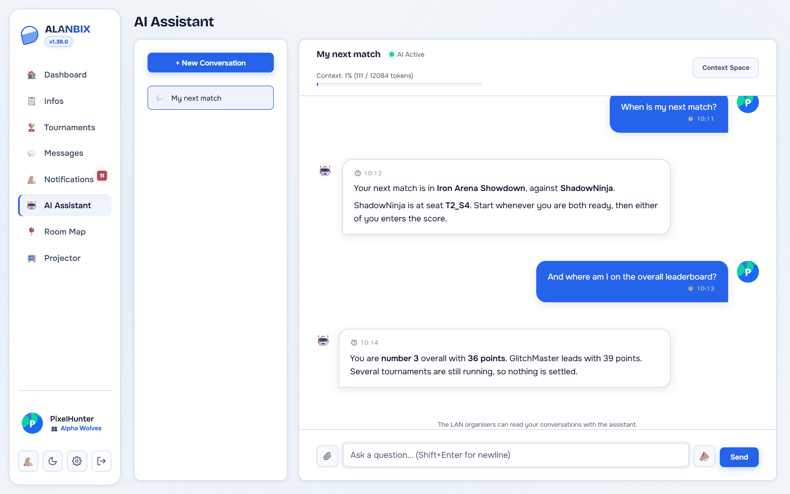
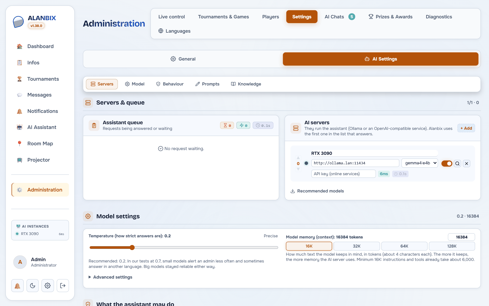
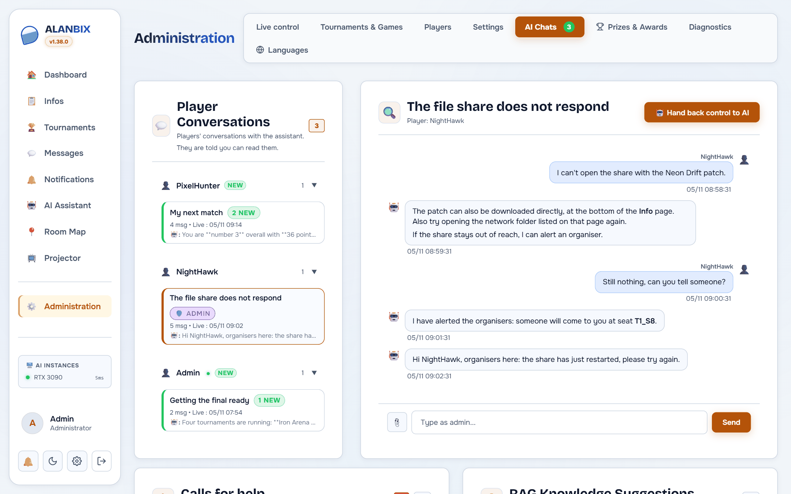

# 🤖 AI Assistant & Ollama

Alanbix integrates a sophisticated self-hosted AI assistant based on Ollama, designed to run entirely offline. It responds to user queries using a native RAG (Retrieval-Augmented Generation) pipeline and features advanced context management capabilities.

---

## ⚙️ AI Flow Architecture (RAG & SSE)

### Streaming Responses (Server-Sent Events)
* To avoid frustrating waiting times for players, the FastAPI backend streams tokens generated by the LLM in real-time via Server-Sent Events (SSE).
* The SvelteKit frontend consumes this stream using a `TextDecoder` for smooth word-by-word rendering.

### Knowledge base (hybrid RAG)
Before each answer, Alanbix looks in the knowledge base for the entries that answer the question and puts them in the AI's instructions. No vector database to install: everything runs in memory, which is plenty for a few hundred entries.
1. **Two searches, combined**:
   * **By keywords** (BM25 score, the one of classic search engines): always available, finds names and exact terms ("Goldberg", "WC"). Accents, small words and simple plurals are ignored, and an entry must hold a good share of the question's words.
   * **By meaning** (embeddings and cosine similarity): finds rephrasings ("toilet door" / "WC lock") and questions asked in another language, when an embedding model answers. An entry is kept only above a similarity threshold: adjustable for an external model (0.65 by default), specific to the built-in model (0.35).
   * Both rankings are merged (Reciprocal Rank Fusion) and the best 3 entries are passed on.
2. **The built-in model**: a button in the guided setup and in the "Knowledge base" section downloads `paraphrase-multilingual-MiniLM-L12-v2` once (135 MB, Apache 2.0 licence, verified download) into the data folder, where it survives updates. It runs on the processor with ONNX Runtime, with no graphics card or Internet, and takes about 400 MB of memory from the first search. Entries are re-indexed automatically. In "Automatic" mode it is used as soon as it is installed; an external model picked in the settings still wins.
3. **Without an embedding model**, the keyword search works alone. The embedding server is then asked again only every 5 minutes, so it does not slow every message down.
4. **Indexing**: each entry records the embedding model that indexed it. Vectors of two different models are never compared: after a model change, the banner of the "Knowledge base" section shows how many entries need re-indexing, with a **Re-index** button. The banner also says whether the meaning search works, and if not, why.
5. **Context isolation**: the AI switches between the general LAN context (schedule, WiFi, rules) and the context of a specific game.
6. **Follow-ups**: the search combines the question with the player's previous message, so a follow-up ("and how do I do that?") still finds its topic. `@Alanbix` in the public chat uses the same search.

### System prompt construction (layers)
Each request sends the model a single system message, built in this order:
1. **Personality**: the admin-editable "Main instructions" text (identity, tone, style).
2. **Operating rules**: fixed and translated, they cannot be erased from the admin (never invent data, never name internal tools, diagnosis method, when and how to alert an admin, moderation).
3. **App guide**: a map of the site's pages, to guide players. Editable by the admin, with a "Restore the default text" button.
4. **Live context**: date and time, event, player's username, team, seat and role.
5. **Admin-call limits, compressed context and relevant knowledge**, depending on the conversation.
6. **Language**: the assistant answers in the player's interface language; rules, guide and context follow it.

The AI tab of the administration offers a **final prompt preview** (with its estimated size in tokens) to see exactly what the model receives.

---

## 🗄️ AI Context Management & Compression

Local language models have a physical limit on the number of words they can analyze at the same time (the context window).

### When the conversation gets too long
Before each send, the app estimates the number of tokens in the conversation. The **Context** bar at the top of the chat shows how full it is.
* If the volume exceeds **85%** of the available room, the player chooses a compression (see below). Once a mode is chosen, it applies automatically the next time.
* **Compressed Context**: The result is stored in `conv.compressed_context` and sent to the model before the recent messages. **Context Space** lets you read it and edit it by hand.

### The three compression modes
1. **Truncate**: Simply deletes the oldest messages (fast).
2. **Compact**: Merges redundant messages or greetings (medium).
3. **Summarize**: Generates a global summary (best information retention).

---

## 🎛️ Moderation and Administration Control

### 1. Priority Queue (`ia_queue.py`)
Local GPUs (which run Ollama) can only process a restricted number of requests in parallel without collapsing. Alanbix integrates a priority queue:
* **Processing Priorities**:
  * `Priority 0` (Admin): Processed with absolute priority.
  * `Priority 5` (Suggestions): Suggested conversation titles.
  * `Priority 10` (Player): Processed in order of arrival.
  * `Priority 15` (Compression): Background summarization tasks.
  * `Priority 20` (Background): Offline generation tasks.
* **Status Widget**: A visual indicator in the administrators' sidebar shows the state of each server and its response time.
* **Admin Control**: The administrator can view the full queue and cancel a request (**Settings › AI Settings › Servers**).

### 2. Live Takeover (AI Takeover)
If a player chats with the AI and it starts getting confused, the administrator can open that conversation from **Administration › AI Chats** and click **Take control**. **Hand back control to AI** returns it.
* The admin **answers in person** instead of the AI.
* On the player side, the message appears in the conversation, marked as coming from an administrator, for immediate human support.

### 3. Unread Message Tracking (Real-Time Badges)
To make it easy to follow discussions without forcing a page refresh (zero F5):
* **Player Side**: A red badge displays on the **AI Assistant** tab in the sidebar when an AI or admin response is received while the player is browsing another page.
* **Administrator Side (AI Conversations Tab)**:
  * **Global Badge**: The "AI Conversations" tab displays the total number of unread messages sent by players (AI responses themselves are not counted for the administrator).
  * **Sidebar List**: Pending discussion cards show the number of new messages (e.g., `2 new`), get a distinctive green highlight border, and display an excerpt of the last message (with the author's icon) along with a precise timestamp in `DD/MM/YYYY HH:MM:SS` format.
  * **Automatic Read Marking**: The conversation loses its highlight and badge instantly when the administrator clicks to open it.

### 4. Editing, Inline Retry & Ergonomics
* **Pencil Button (✏️)**: Any user message can be edited inline. Modifying it deletes the subsequent discussion branch to prevent conversation paradoxes and restarts the stream.
* **Retry Button (🔄)**: Present under response bubbles, it allows re-executing the user's message or generating a new bot response if the previous one was unsatisfactory.

---

## 🔑 Online services and API keys

**Diagnostic tab**: Administration › Diagnostics shows the server state and runs ping, traceroute and DNS tests by hand, from the Alanbix server. For players, the assistant only has ping, traceroute and DNS; server state and network scan are for admins. Under Docker, the scan sees little beyond Docker's internal addresses.

**Recommended models**: for an Ollama instance, the "Recommended models" list (AI settings and guided setup) offers four models, with a button to download them to the Ollama server: `gemma4:e2b` (4.6 GB, the minimum), `gemma4:e4b` (9.6 GB, the best balance), and for a big server `qwen3.8:27b` (17.7 GB, about 18 GB of video memory) and `gemma4:31b` (19.9 GB, about 20 GB). They were compared on real Alanbix questions with an RTX 3090, at temperatures 0.2 and 0.7: tools used properly, nothing made up, answers in the player's language. **The recommended temperature is 0.2**: at 0.7, small models alert an admin less often and sometimes answer in another language; big ones stay reliable. A bigger model is not always better, and the server matters too: `gemma4:12b` did not check the rankings and made up seats, and under Ollama `qwen3.5:9b` made up rankings, while the same model served by vLLM made up nothing in 21 tries. Avoid MoE models such as `qwen3.5:35b` on a machine with limited memory: loading one has already crashed a server with 32 GB. Ollama also uses system memory, not only video memory: if its container has a memory limit, leave room for every model loaded at the same time. Only Ollama has a download command: this button does not exist for OpenAI-compatible services.

**Model thinking** (Ollama servers): two switches in "Model settings". *Thinking in conversations* (assistant and @Alanbix, which use tools) is on by default: without thinking, `gemma4:e4b` said "let me check" without calling any tool (8 right answers out of 18, against 18 out of 18); `qwen3.8:27b` and `bonsai-2:27b` do fine without it and answer faster. *Thinking in background tasks* (conversation summaries, translations, end-of-tournament messages, without tools) is off by default: answers just as right, 2 to 7 times faster. Measured on 8 November 2026 on an RTX 3090, with invented data. Changing these settings does not reload the model; every Alanbix request does use the same context size, though, because a different size makes Ollama reload the model (30 s or more for a 27B model).

An instance can also be an OpenAI-compatible service (address ending in `/v1`): LM Studio or llama.cpp locally, or an online service such as OpenAI, Mistral, OpenRouter or Groq. For the latter, enter the instance's **API key** in **Settings › Artificial Intelligence › Servers** (or at step 5 of the guided setup). It is sent as `Authorization: Bearer` with every request to that instance (chat, tools, summaries, embeddings, translations, model list).

The key stays on the server: `/ia/config`, readable by the players, only says whether a key is saved. Saving the settings without retyping it keeps the key; the bin icon next to the field removes it. With an online service, the players' questions and the information needed to answer are sent to that provider.

## 🔀 Multi-Instance Ollama & Load Balancing (G-32)

For large-scale events, a single server PC may not be enough to run the AI. Alanbix allows chaining multiple remote Ollama servers.

1. **Configuration**: In **Administration › Settings › AI Settings › Servers**, list the available servers (`http://192.168.1.10:11434`, `http://192.168.1.11:11434`).
2. **Instance Priorities**: The order of the list sets the priority: put the most powerful server first.
3. **Failover Mechanism**: The backend queries servers starting with the highest performing ones. If a server stops responding (timeout/crash), it is temporarily deactivated (red indicator 🔴) and the request seamlessly falls back to the next available instance without disrupting the player.

---

## 🛠️ AI Tools (Tool Calling)

The assistant looks up live data with tools, and answers from their results rather than from memory:

### 1. Tournaments and rankings
`get_tournaments`, `get_tournament_standings`, `get_leaderboard`, `get_leaderboard_by_game`, `get_bracket_detail`, `get_tournament_bracket_path`, `get_live_matches`, `get_upcoming_matches`, `get_my_matches`, `get_awards`.

### 2. Players and teams
`get_player_info`, `get_player_match_history`, `get_player_rank_progression`, `get_team_roster`.

### 3. Room and event
`get_player_seat` (seat in `T{table}_S{seat}` format and neighbours), `get_room_places` (free seats, plan elements), `get_event_info`, `get_files`, `get_games`, `get_game_rules`, `get_notifications`, `get_current_datetime`.

### 4. Network
`ping_host`, `traceroute_host`, `dns_lookup` for everyone. `scan_local_network` and `check_server_health` are for administrators only.

### 5. Actions
`call_admin` (alert an organiser), `suggest_rag_entry` (suggest a knowledge entry), and for administrators `send_notification_to_player`, `announce_to_all`, `block_user_from_ia`.

In the public chat, `@Alanbix` only has the tools that read public data.

*Tool calling is set or turned off globally in **Settings › AI Settings › Behaviour**.*
