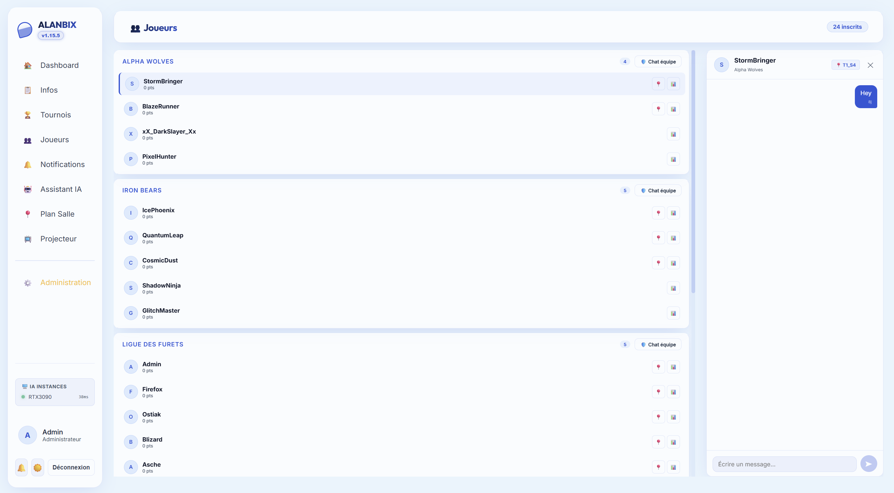
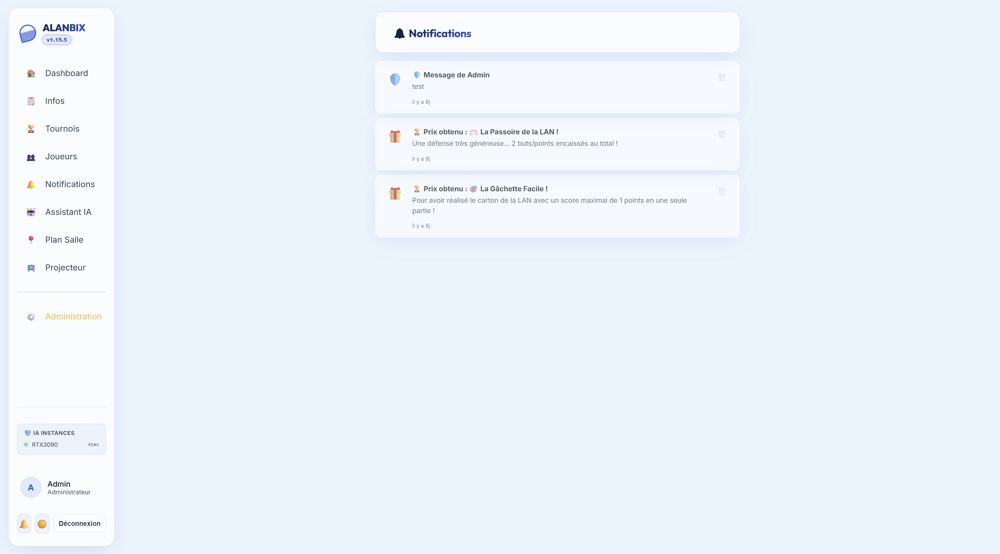

# 💬 Direct Messaging & Notifications

Alanbix integrates real-time communication channels and a unified notification center to streamline information exchange and animate the event.

---

## ✉️ Chat Systems (Real-Time)

Alanbix manages chat streams via persistent WebSocket connections (`/ws` handled in `websockets.py`). Messages are instantly delivered to recipients without requiring them to refresh their page.

### 1. Peer-to-Peer Private Chat (P2P)
* By clicking on a player profile from the directory, a direct messaging space opens.
* Messages are stored in the SQLite `messages` table.
* The system automatically generates red notification badges with an unread message count next to the sender's name in the directory and on the global messaging tab in the sidebar.

### 2. Deterministic Team Group Channels (G-53)
For team tactics and LAN community needs, Alanbix integrates a group chat system with channel keys calculated deterministically server-side:
* **Private Team Chat (🛡️)**: Reserved exclusively for players sharing the same `User.team_name`.
  * *Channel Key*: `team:[TeamName]` (e.g., `team:Alpha Wolves`).
  * The interface access buttons feature a distinctive purple pulsing animation.
* **Inter-Team Chat (⚔️)**: Allows two different teams to challenge each other or chat.
  * *Channel Key*: `inter:[TeamNameA]|[TeamNameB]`. The names are systematically sorted alphabetically to guarantee that the channel key is identical regardless of who initiates the chat.
  * *Security Control*: Only members of the two concerned teams (or an administrator) can read or post in this channel. The backend rejects any other attempt.

### 3. Shared Rich Chat Features (P2P & Groups)
Both direct and group chats enjoy the full modern feature set of the public chat:
* **Live Emoji Reactions**: Quick hover bar (`👍`, `🔥`, `🏆`, `➕` with full categorized picker) and interactive reaction counter pills.
* **Replies & Contextual Quotes**: Reply button (`↩`) with instant jump and highlight animation to original message.
* **Image & Meme Attachments**: Send images (PNG, JPG, WebP, GIF up to 8MB) via drag-and-drop, clipboard paste (`Ctrl+V`), or attachment paperclip button, with preview thumbnail and full-screen lightbox.
* **Automatic Link Previews (OpenGraph)**: Rich cards featuring site title, description, and thumbnail for posted URLs.
* **Real-time Typing Indicators**: Live visibility of peers currently typing via WebSockets.
* **Sound Alerts & Profanity Filter**: Gentle Web Audio chime on direct `@username` mention (with header mute toggle `🔊`/`🔇`) and client-side courtesy shield (`🛡️`/`👁️`) masking offensive words (`f**k`).
* **Privacy & AI Exclusion**: The `@Alanbix` bot is strictly confined to the public chat and never participates in private or team chats.

### `@Alanbix` in the public chat
Mention `@Alanbix`, or reply (`↩`) to one of its messages, and the AI assistant joins the conversation with the personality set by the administrator. Its answer is shown as a reply to the player's message.
* **It follows the conversation**: it reads the last 20 messages (last 30 minutes) with who speaks and whom each message replies to, plus the older messages the question replies to. Its own answers are marked so it does not repeat itself.
* **It knows the player asking**: team, seat and upcoming matches, even with a small model without tools ("which match do I play?").
* **It looks up live data**: tournaments, matches, brackets, rankings, teams, seats, games and rules, files and event info, with read-only tools. The tool calling mode of the AI settings applies (off = no tools). The knowledge base is used too.
* **Nothing private, no action**: as the whole room reads the answer, it does not read a player's notifications, alert an administrator, send notifications or announcements, or block anyone. For that, it points to the private AI Assistant.

---

## 🔔 Notification Center (Real-Time)

The bell icon in the sidebar opens the notification center (SQLite `notifications` table).

### Notification Types
1. **Admin Notifications (`admin`)**: Sent when an organizer publishes a general announcement or manually replies to a technical chat.
2. **AI Tournament Notifications (`tournament_ia`)**: Animation messages written by the local LLM assistant at the closing of a tournament (see below).
3. **Award Notifications (`award`)**: Alerts pushed in real-time when a player inherits or is dethroned from an automatic distinction (gift icon 🎁).

### Match Summaries by AI
Upon closing a tournament, for each participant, the server adds an AI generation task to the queue.
* **The Concept**: The AI writes a personalized, teasing, or encouraging summary of the player's performance during the tournament (e.g., *"You won your first 3 matches easily before stumbling in the semi-finals against PixelHunter... Keep pushing!"*).
* **System Notification Prompt**: Configurable by the admin.
* **Resilience**: If the Ollama instance crashes or returns a timeout during message generation, the notification system displays an error alert on the admin dashboard with a **"Retry Generation"** button to re-submit the task to the AI queue without blocking the rest of the application.
