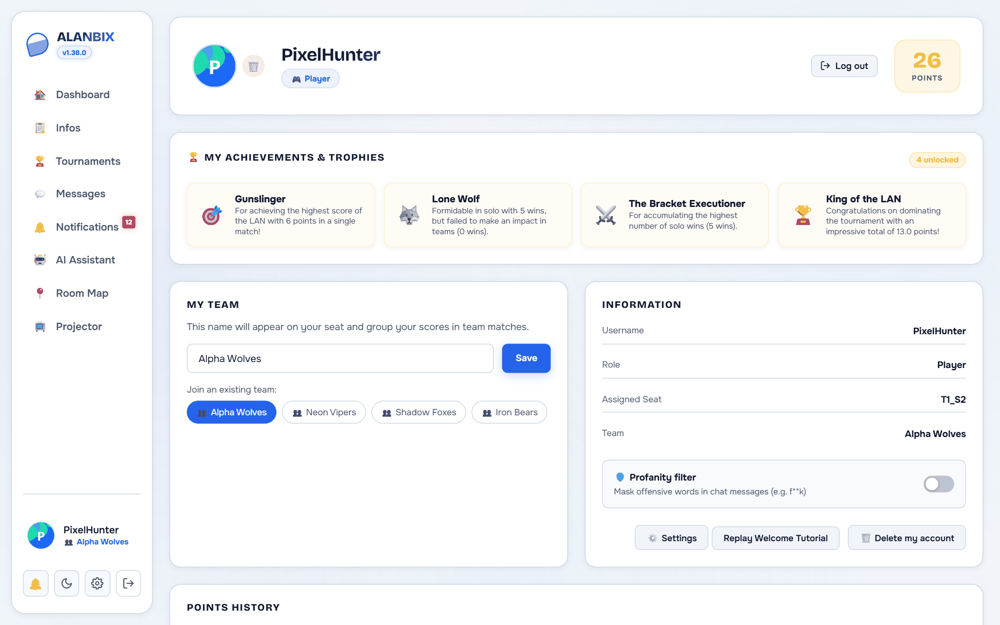
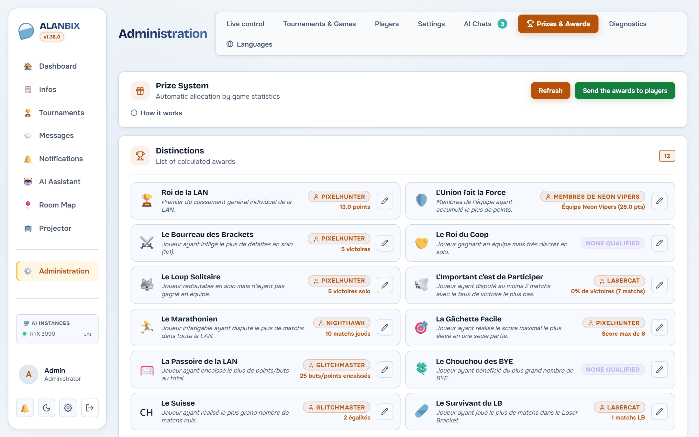

# 📊 Leaderboards, Statistics & Awards

Alanbix offers a complete system to track individual and team performances throughout the LAN. Leaderboards are calculated both persistently (in the database) and predictively (real-time frontend standings).

---

## 🏆 Global Individual Leaderboard

Accessible from the **Leaderboard** tab of the home page and on the Projector. It lists players sorted by points: points already earned (the `points` column of the `users` table), plus the provisional points of running tournaments.

### Progression Indicators (↑↓ NEW)
To make the leaderboard dynamic, the frontend memorizes the last state of the leaderboard in the `previousLeaderboard` variable (temporary persistence in local memory).
Upon each data refresh (via API or WebSocket):
* If a player goes up $N$ places: A green **↑N** badge appears next to their name.
* If a player goes down $N$ places: A red **↓N** badge appears.
* If a player was not present in the Top 10 in the previous snapshot and makes an entry: An orange **NEW** badge is displayed.
* If their position is unchanged: No badge is displayed.

---

## 👥 Team Leaderboard

This ranking groups players by the value of their `User.team_name` column (their global team declared on their profile). Team rows are colored in purple (`var(--primary-purple)`) to distinguish them from individual rankings.

### The 2 Score Calculation Modes
The administrator can choose the calculation mode from **Administration › Settings › General** (SQLite configuration key `team_scoring_mode`):

1. **Raw Mode (`raw`)**:
   $$\text{Team Score} = \sum \text{Points of all members}$$
   *Ideal if all teams have the same number of players.*
2. **Weighted Mode (`weighted`)**:
   $$\text{Team Score} = \frac{\sum \text{Points of all members}}{\text{Number of team members}}$$
   *Recommended if team sizes are unbalanced. This prevents an 8-player team from systematically crushing a 3-player team.*

### Expandable View (Members Details)
Clicking a team row in the standings instantly expands a panel listing all members of that team, sorted by individual points, thus showing the exact contribution of each member to the global score.

---

## 🗂️ Player Sheet, Profile & Custom Avatars
Clicking a player's name anywhere in the application (leaderboards, directory, tournament tree) opens a complete profile modal (opaque background `var(--bg-secondary)`) displaying:
1. **Key Statistics**: Total score, number of tournaments played, and awards won.
2. **Match History**: The complete list of tournaments the player participated in. For each tournament, a colored badge indicates the status (**REGISTERED**, **RUNNING**, **CLOSED**), their final rank, and the detailed calculation of points obtained (e.g., +10 win, +1 participation, +1.5 goals).
3. **Trophy Showcase**: Automatic awards granted to the player.

### 🎨 Integrated Avatar Editor
From their Profile page, players can upload their own avatar. A mini-visual editor (Canvas) opens on image import to allow:
* **Zoom In / Out**: Adjust the image size (0.5x to 4x) using a slider.
* **Crop / Drag**: Reposition the image to the pixel using the mouse or finger (on smartphones).
* **Background Color (transparency)**: Fill the background of transparent PNG images with a solid color (Transparent, White, Black, Alanbix Blue, Dark, or custom color).
* **Shape Choice**: Configure the shape of the avatar rendering mask:
  * **Circle** (default)
  * **Rounded** (square with softened corners)
  * **Square** (pure square without rounding)
* **Global Propagation**: The shape chosen by the user is stored in the database and applied dynamically across the entire application interface (Sidebar, Leaderboard, Chat boxes, Tournament Brackets, 2D Room Plan, Projector view, and Admin Panel).

---

## 🎁 Automatic Awards System

At each tournament closing, the server recomputes 12 awards from all the LAN's data (`awards` table). They can be viewed in **Administration › Prizes & Awards**, where **Send the awards to players** notifies the winners and shows the awards on their profile.

### The 12 Managed Trophies
1. **King of the LAN**: Player in 1st place in the general ranking.
2. **Strength in Numbers**: Team in 1st place in the team ranking.
3. **The Bracket Executioner**: Player who inflicted the most defeats on other players.
4. **The Coop King**: Player with the most wins in team tournaments.
5. **Lone Wolf**: Player with the most wins in solo tournaments.
6. **The Marathoner**: Player who played the most matches, across all tournaments.
7. **Gunslinger**: Player with the highest top score in a single game.
8. **The LAN Sieve**: Player who conceded the most points or goals.
9. **The Lucky Bye Favorite**: Player who benefited from the most BYEs.
10. **The Swiss**: Player with the most draws.
11. **LB Survivor**: Player who played the most matches in the losers bracket.
12. **The Important Thing is to Participate**: Player with the lowest win rate among those who played at least 2 matches.

### Notifications and Personalization
* **Notification**: After sending from the administration, each winner receives a notification (type `award`) describing their award.
* **Admin Personalization**: The titles and descriptions of the awards can be edited in the administration interface. The descriptions support dynamic variables interpolated by the server during display (e.g., `{points}`, `{wins}`, `{matches_played}`).

---

## 📊 Live Standings

When a tournament is in **RUNNING** status (active play):
* The system dynamically calculates on the frontend a provisional ranking based on the current state of the bracket matches (number of wins accumulated $\times$ points per win + scores scored $\times$ goal multiplier).
* This ranking displays as a mini-leaderboard directly under the bracket with a flashing **LIVE** badge.
* *Integrity Security*: This calculation is purely visual and does not alter the `points` column in the SQL database until the administrator officially closes the tournament.
