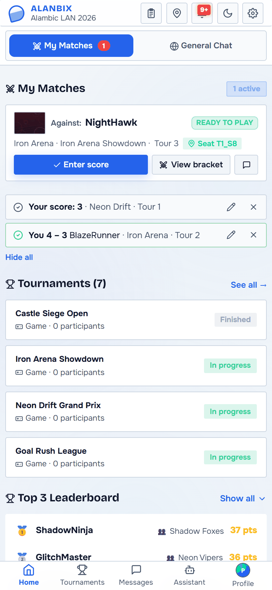
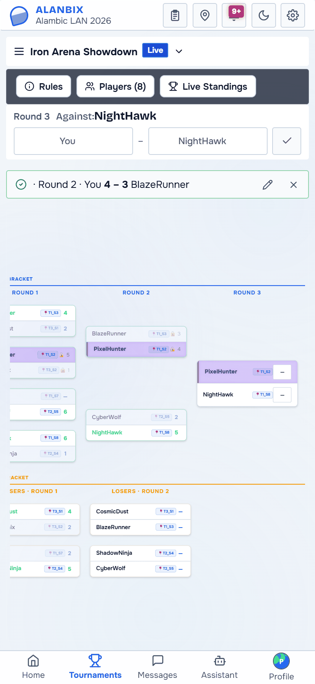
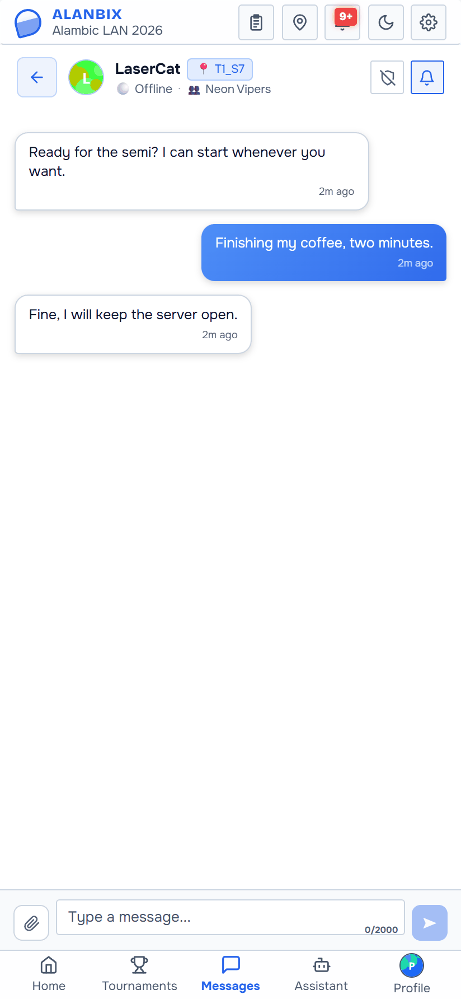
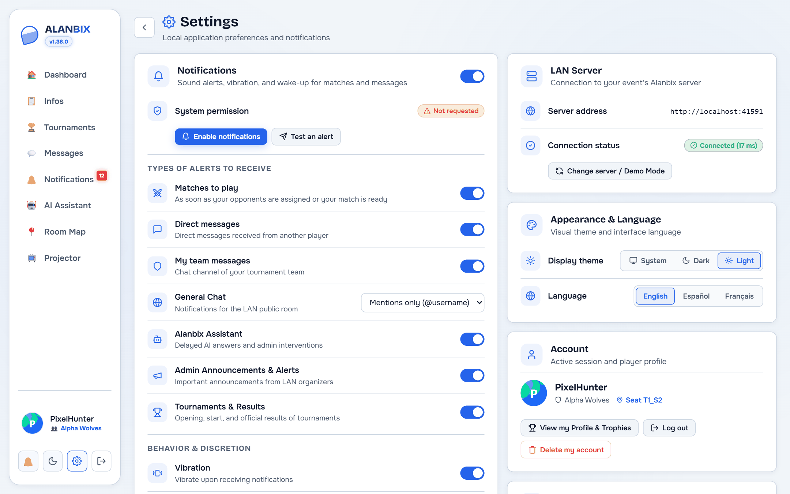

# 📱 Mobile Companion App & Settings (Android & iOS)

  
  
  

The **Alanbix Companion** mobile app lets participants and organisers of a LAN party follow their tournaments, talk to the community and receive their alerts on their phone, without relying only on their gaming PC.

---

## 1. "Player-First" Mobile Layout

On phones and tablets (`<= 900px`), the interface adapts automatically:
- **The PC sidebar and the Projector are hidden** to keep the useful space. Administrators still reach the administration through its button in the top bar.
- **Compact top bar**:
  - Logo and LAN event name.
  - Shortcuts to the LAN info (📋), the room map (📍), the notification center (🔔) and the settings screen (⚙️).
- **Fixed bottom navigation** with 5 touch tabs:
  1. `🏠 Home`: Quick tabs **"⚔️ My Matches"** (ready-to-play action cards, assigned opponent, link to the seat and score entry) and **"🌐 General Chat"**.
  2. `🏆 Tournaments`: Running or open tournaments with touch navigation in the brackets.
  3. `💬 Messages`: Player-to-player messages and team channel in a *Master / Detail* view (list of players, then full-screen chat with a back button).
  4. `🤖 Assistant`: AI technical support with a side history drawer and a call to the administrators.
  5. `👤 Profile`: Game statistics, awards and trophies won, and points history.

---

## 2. Three Connection Modes & Network Discovery

The app is set up through the server connection dialog (from Settings or at first launch):
1. **Automatic Wi-Fi search (Auto-Discovery)**:
   - Detects Alanbix servers on the local subnet (mDNS broadcast and IP/port 41481 probe).
   - One-tap connection to the detected server.
2. **Manual IP address or domain name**:
   - For connections through a specific router, VPN or reverse proxy (`http://192.168.1.50:41481` or `https://lan.domain.org`).
3. **Offline Demo Mode (for stores & tests)**:
   - Explore the whole dashboard with simulated data (matches, messages, trophies) without a running server.

---

## 3. Native Notifications on a 100% Local LAN

Unlike apps relying on cloud services (Firebase FCM or Apple APNs), Alanbix has its own engine for closed local networks:
- **On Android**:
  - Foreground service (`AlanbixPushService`) keeping a permanent OkHttp WebSocket connection to the LAN server.
  - Works with the screen locked and after the device restarts (`RECEIVE_BOOT_COMPLETED`).
  - Android notification channels (Matches, Messages, Teams, Announcements, Tournaments).
  - Deep links (`alanbix://`) to open the right conversation or score entry when a notification is tapped.
- **On iOS**:
  - *Local Push Connectivity* extension (`NEAppPushProvider`) enabled on the LAN Wi-Fi SSID.

---

## 4. Settings Screen (`/dashboard/settings`)

The settings screen gathers the app's local settings:
- **Notification status**: system permission check, test alert button, and background service management.
- **Filter by alert type**: selective activation (matches to play, private messages, team chat, general chat mentions, AI answers, admin announcements, tournaments).
- **Behaviour & Discretion**: vibration, sounds, and *Do not disturb* hours (with exceptions for ready matches and admin emergencies).
- **LAN Server**: connected URL, latency (ping ms), declared Wi-Fi SSIDs and a shortcut to change server.
- **Appearance & Language**: light/dark theme and immediate language choice (`fr`, `en`, `es`).
- **Account**: session status and secure sign-out (revoking the device token registered on the server).

