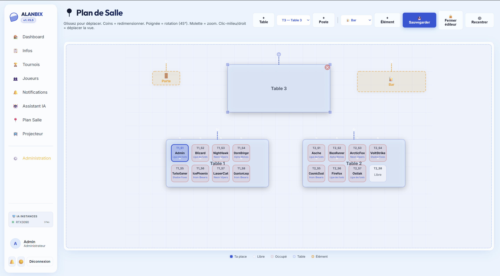
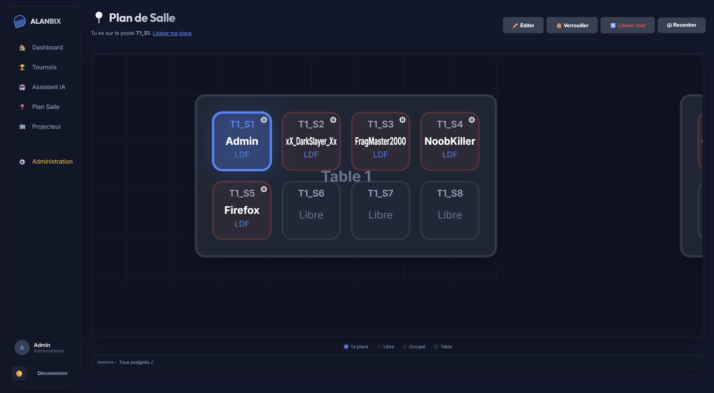

# 🗺️ Interactive Room Plan

Alanbix's interactive room plan graphically represents the physical layout of the LAN, manages seat assignments, and makes it easy to locate participants.

---

## 🛠️ The Room Editor (Administrator View)

Accessible from **Administration > Room Plan**. This editor allows designing the physical layout of the event using an interactive 2D canvas.

### Available Elements (Sidebar Palette)
You can Drag & Drop the following elements onto the canvas:
* **Seat**: The primary element on which a player can sit.
* **Table**: Furniture of different sizes to structure rows.
* **Structural Elements**: Walls, Doors, Technical Racks, Projection Screens.
* **Amenities**: Kitchen corner, Food bar, Restrooms (WC).

### Actions on Canvas Elements
* **Selection and Movement**: Click a table or an element to select it (blue outline): a panel opens in the corner of the map with its name, seat count, "Auto seats", "Add a seat", **Rotate 90°**, **Duplicate** (a table with its seats, placed on the first free spot below) and **Delete**. Hold the click to move it: **alignment guides** appear when its edges or centre line up with another object, and a stack of tables snaps to an equal gap (pink markers). Clicking the empty map deselects.
* **Keyboard**: arrows move the selection (Shift: 5 cells), Del deletes (Enter confirms a table), Ctrl+D duplicates, Esc deselects, Ctrl+Z / Ctrl+Y undo / redo (100 steps), Ctrl+S saves.
* **Unsaved changes**: a "Not saved" mark shows next to the Save button; closing the editor or leaving the page then offers to stay, discard the changes or save.
* **Readability**: seats show their number (`7` rather than `T1_S7`), only the selected table shows its `+` button, and elements (door, kitchen, bar, toilets, rack, screen) use the app's line icons.
* **Coordinated Rotation**: Clicking the rotation handle of a table (at its right end) and rotating it automatically moves and aligns all associated seats in a circular arc around the table's center.
* **Delete Confirmation (Table)**: Deleting a table displays a visual confirmation overlay (`✓` / `✕`) shown in the middle of the table, in place of its name, to prevent accidental clicks, and automatically cascades deletion to all associated seats.
* **Direct Seat Addition**: Seats go **around** the table, like chairs: one row along the top edge, then one along the bottom edge, centred on its length. A green `+` button (ghost seat) appears at the next free place; clicking it generates a seat with a unique sequential ID (e.g. `T5_S9`). The button skips places covered by another table or seat, and disappears when both rows are full: for more places, make the table longer (a 300-wide table holds 5 seats per side). A seat stays bound to its table by its ID, so it follows the table when it is moved or rotated. A new table is thin (80 deep) and is placed leaving room for its seats. The toolbar's **+ Seat** button keeps going beyond that, on extra rows just above and then below the table. Older maps, with the seats on the table, keep working.
* **Auto seats**: on by default for every new table (which therefore comes with its seats) and for the generator's tables; ticked for the selected table (clicking a table selects it), this box gives the table as many seats as its length holds, and adds or removes them while it is resized. Adding seats one by one is then locked on that table until the box is unticked. A seat a player sits on is never removed: it moves to an extra row.
* **Tight Auto-Recentering**: The **Recenter** button (as well as the initial page load) dynamically calculates the bounding box of all elements (tables, seats, decorations) to adjust zoom and center the room plan with an optimized `15px` padding.
* **Save**: Changes automatically sync in the background with the SQLite `room_items` table.

---

## 🪑 Seat Assignment

The system manages the association between user accounts and seat IDs placed on the map.

### Self-Service Choice (Player)
* From the public Room Plan view, a logged-in player can click a free seat to reserve it.
* Their username and avatar immediately appear on the plan for all other users thanks to WebSocket synchronization.
* If the player changes their mind, they can click their own seat to "Free the seat".

### Administration and Manual Assignment
* The administrator can click any seat and use a dropdown containing the list of registered players to manually assign a participant to a seat.
* **"Free All" Button (Bulk Unassign)**: Located in the header of the admin editor. This button sends a `POST /room/admin-unassign-all` request to the backend to instantly unassign all players in the room in one go (handy when resetting the event). A "Yes, free all" confirmation is asked first.
* **Empty map**: while no table or seat exists, the page shows an explanation; administrators get a "Draw the map" button that opens the editor.

---

## 🖱️ Advanced Navigation: Cursor-Centered Zoom

To deliver a fluid experience, the room plan features a 2D manipulation engine (Pan & Zoom) written in Vanilla JS without any heavy external dependencies.

* **Centered Zoom**: Using the mouse wheel zooms directly toward the physical position of the mouse pointer (and not toward the top-left corner of the container).
* **Pan (Movement)**: Hold down the left mouse button (or drag with a finger on tablets/mobiles) to pan the map.
* **Drag-Threshold Security Filter**: The system applies a minimum pixel threshold before validating a drag movement. This prevents accidentally moving the map when a player simply wants to click their seat.

---

## 🔗 Synergy with Tournament Brackets

A unique feature of Alanbix is the cross-referencing of physical location data and the status of tournament matches:
* In the tree of an active tournament, next to each player's username in a match, a small badge represents their seat number (e.g., **#B12**).
* **Location Click**: Clicking this seat badge teleports the user directly to the Room Plan view, automatically centers the camera on that player's workstation, and applies a pulsing animation to highlight it.
