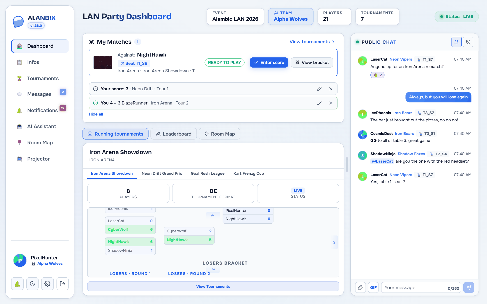

# 🚀 Quick Start Guide

This guide helps you install and configure Alanbix for the first time for your event.

---

## 💾 Prerequisites
* **Docker & Docker Compose** installed on your LAN server.
* **Ollama or OpenAI-compatible endpoint (LocalAI, etc.)** (optional but recommended for AI) running locally or on the network.

---

## 🛠️ Step 1: Deployment

Alanbix can be installed in three different ways depending on your production and development needs.

### Option A: From Docker Hub (Recommended for Production)
For a quick deployment without compiling the code, use the unified standalone image available on Docker Hub (`aschefr/alanbix:latest`):

```bash
docker run -d \
  -p 41481:41481 \
  -v alanbix_data:/app/data \
  --name alanbix \
  aschefr/alanbix:latest
```

* The application runs on the single port `41481` (which serves both the frontend and the backend).
* SQLite database files and uploads are stored in the persistent volume `alanbix_data`.
* **Login secret key**: on first start, Alanbix generates a unique random key and stores it in the volume (`/app/data/.secret_key`). Keep this volume: if it is lost, everyone simply has to log in again. To provide your own key, set the `SECRET_KEY` environment variable.
* **Access from other sites (CORS)**: by default, only the machine itself, the mobile app, the local network and Tailscale are allowed. For another address (domain name, reverse proxy…), set `CORS_ORIGINS` (comma-separated list, or `*` to allow everything).
* **Account used in the container**: since version 1.37, the app no longer runs as root but as an ordinary account, `1000:1000` by default. On start, the data folder is handed to it automatically, including the one of an older install. For another account, set `PUID` and `PGID` (on Unraid: `PUID=99` and `PGID=100`).

#### 🔍 (Optional) Deploying SearXNG for Game Cover Search
If you want to use the automated game cover search feature with the Docker Hub image, you must run a SearXNG instance alongside it:
1. Create a `settings.yml` file with JSON format enabled (required by the backend):
   ```yaml
   use_default_settings: true
   server:
     secret_key: "change_this_to_a_secure_random_string"
   search:
     formats:
       - html
       - json
   ```
2. Start the SearXNG container:
   ```bash
   docker run -d \
     -p 8888:8080 \
     -v /path/to/settings.yml:/etc/searxng/settings.yml \
     --name alanbix_searxng \
     searxng/searxng:latest
   ```
3. In **Administration › Settings › General › Services**, enter your SearXNG URL (e.g. `http://<YOUR_SERVER_IP>:8888`), then click **Test the connection**.

---

### Option B: Clone the Repository (For Development and Code Changes)
If you wish to modify the code or run the project locally with Hot Module Replacement (HMR):

1. Clone the git repository:
   ```bash
   git clone https://github.com/Aschefr/Alanbix.git
   cd Alanbix
   ```
2. **(Optional - For LAN network access)**: to reach it from other devices on your local network, tell browsers where to find the API:
   * Copy the sample configuration file:
     ```bash
     cp .env.example .env
     ```
   * Add your host machine's address to `.env`: `VITE_API_URL=http://192.168.1.50:8000`.
3. Launch the development containers:
   ```bash
   docker compose up -d --build
   ```
4. The application is then accessible at:
   * **Web Interface (Frontend)**: `http://localhost:41481` (or `http://<YOUR_LAN_IP>:41481` from the LAN)
   * **API Documentation (Backend)**: `http://localhost:8000/docs`

---

### Option C: On Unraid (Community Applications / XML Template)
Alanbix is available in Unraid's **Community Applications** store:

1. Open the **Apps** tab in your Unraid interface and search for **Alanbix**.
2. Click **Install**, check the port and the `appdata` folder, then click **Apply**.

*(Without the store)*: copy the [`alanbix.xml`](https://github.com/Aschefr/unraid-templates/blob/master/alanbix.xml) template from the `Aschefr/unraid-templates` repository to `/boot/config/plugins/dockerMan/templates-user/` on your Unraid USB flash drive, then choose **Add Container > User Templates > Alanbix**.

#### 🔍 (Optional) Setting up SearXNG on Unraid
If you run Alanbix on Unraid and want game cover search:
1. Go to the **Apps** tab (Community Applications) on Unraid, search for **SearXNG** and install it.
2. Edit the SearXNG configuration file located on your Unraid appdata share:
   Usually at `/mnt/user/appdata/searxng/settings.yml`.
3. Ensure JSON output is enabled by adding `json` to the search formats:
   ```yaml
   search:
     formats:
       - html
       - json
   ```
4. Restart the SearXNG container in Unraid.
5. In **Administration › Settings › General › Services**, set the SearXNG URL to `http://<YOUR_UNRAID_IP>:<SEARXNG_PORT>`.

---

---

## 👑 Step 2: Create the Administrator Account

Alanbix automatically assigns global administration rights to the **first user created** in the application.

1. Go to `http://localhost:41481`.
2. Click on **Register** (S'inscrire).
3. Fill out the form (username and password).
4. You land on the **guided server setup**: LAN name and language, Wi-Fi and the players' address, info page (pre-filled template), games and a first tournament (with the points scale and its simulation), AI assistant (local or an online service with an API key), knowledge base (built-in search model to install, first entries), room map, then inviting players (address, QR code and printable poster). Every step can be skipped; the setup can be resumed from the administration (**Settings › General › Guided setup**).
5. The **Administration** tab then appears in your left sidebar.

**Signing in later**: enter your username, **Next**, then your password (the eye icon shows it). A session lasts 3 days and renews with use; when it ends, the app returns to the sign-in screen.



---

## ⚙️ Step 3: Global Configuration

Go to **Administration › Settings**. Changes are saved automatically:

* **LAN Name**: Personalize the application header (e.g., *Retro LAN 2026*).
* **Team Scoring Mode**:
  * *Raw*: Sum of all members' points.
  * *Weighted*: Sum divided by team size (prevents penalizing smaller teams).
* **Assistant prompts** (**Settings › AI Settings › Prompts**): Customize the AI personality (e.g. *"You are the official commentator of a fun LAN party"*).

---

## 🎮 Step 4: Games, Room Plan & AI

For features to be usable, the administrator must prepare the environment:

1. **Adding Games**: In **Administration › Tournaments & Games**, **Library** section, click **Add a Game**. Use the built-in SearXNG search to download game covers directly to your server, for offline-first use.
2. **Room Plan**: Open the **Room Map** page, then **Edit**: add tables (with their seats) and elements (door, bar, toilets, Wi-Fi access point…), move them, then **Save**. Players can then click these seats to reserve their physical spot in the room.
3. **AI Activation**: In **Administration › Settings › AI Settings › Servers**, add the URL of your Ollama or OpenAI-compatible instance (e.g. `http://192.168.1.100:11434` for Ollama, or `http://192.168.1.100:8080/v1` for OpenAI/LocalAI), assign a model and check its status.

---

## 🏆 Step 5: Launching the First Tournament

1. Go to **Administration › Tournaments & Games**, **Create a tournament** block.
2. Follow the 3-step wizard:
   * **General**: Name the tournament, link the pre-configured game.
   * **Format**: Choose individual or team play (and set the team size).
   * **Format and points**: Choose the format (e.g. *Double Elimination*) and set the points awarded.
3. The created tournament then appears with status **OPEN**. Your players can sign up from the **Tournaments** page!

---

Next step: Consult the **[Tournament Engine](features/tournaments.md)** guide to learn how to manage and close brackets.
