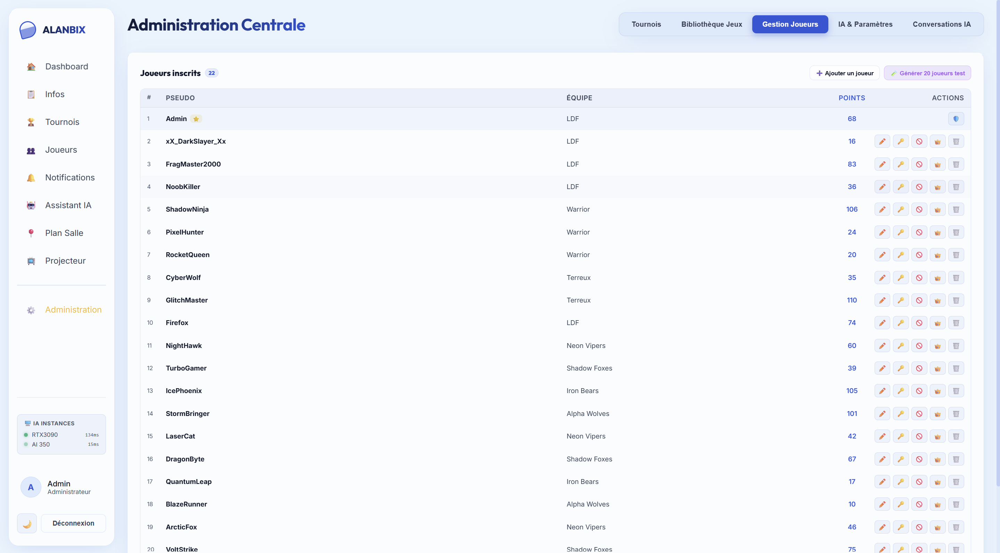
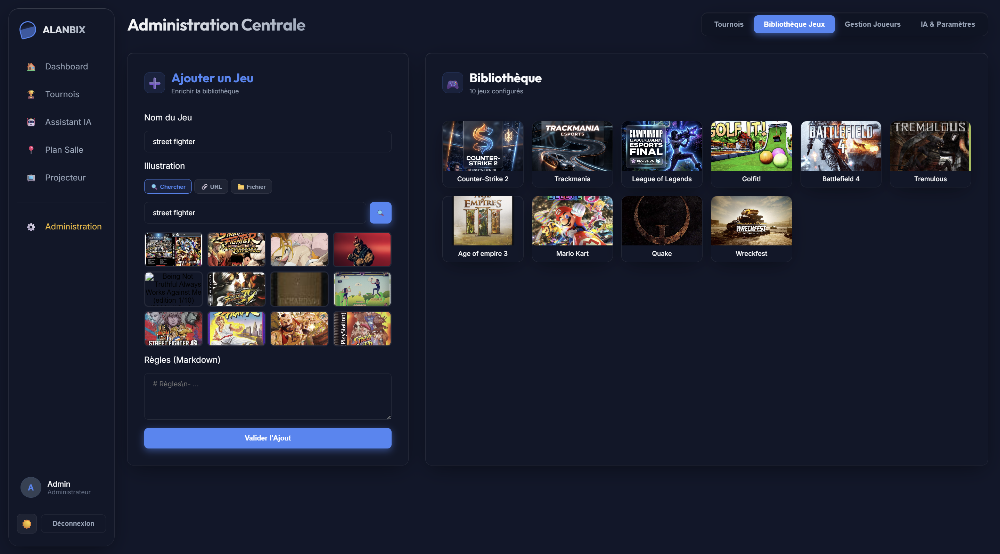

# 🛡️ Administration Système & Contrôles

Le panneau d'administration d'Alanbix (accessible uniquement aux utilisateurs ayant `is_admin = true` en base de données) regroupe les outils de modération, la gestion des jeux, et les commandes de maintenance de l'application.

---

## 🧭 Configuration guidée du serveur

Le premier compte créé sur un serveur neuf (l'administrateur) arrive sur **Configuration du serveur** (`/dashboard/setup`) au lieu de l'accueil joueur. Huit étapes, chacune pouvant être passée :

1. **L'événement** : nom de la LAN et langue par défaut.
2. **Le réseau** : noms du Wi-Fi de la LAN (reconnus par l'application mobile) et adresse à donner aux joueurs (avertissement si c'est une adresse `localhost`).
3. **La page Infos** : modèle prérempli (horaires, Wi-Fi, repas, règles générales) à compléter dans l'éditeur Markdown.
4. **Jeux et tournois** : vérification de SearXNG (avec l'aide pour l'installer), ajout de jeux avec leur jaquette, les quatre formats expliqués avec un exemple de règles, le barème de points expliqué, et un premier tournoi créé sur place.
5. **L'assistant Alanbix** (facultatif) : pas d'assistant, un modèle local (Ollama) ou un service en ligne avec une clé d'API ; test de connexion, choix du modèle et taille de contexte.
6. **Le plan de salle** (facultatif) : générateur de tables (nombre de tables, places par table, tables par rangée) avec aperçu.
7. **Inviter les joueurs** : adresse, QR code et affiche imprimable.
8. **Récapitulatif** : « Terminer » ou « Je participe aussi » (enchaîne sur l'accueil joueur).

La progression est enregistrée sur le serveur (`admin_setup`). L'administration affiche un bandeau tant que la configuration n'est ni terminée ni masquée, et **Réglages › Général › Configuration guidée** la relance. Après une réinitialisation complète, elle réapparaît.

---

## 🎚️ Régie (onglet par défaut)

La Régie rassemble ce qui demande l'attention de l'organisateur pendant la LAN :
* **Appels à l'aide** : demandes d'escalade venues de l'assistant IA. « Voir » ouvre la conversation d'origine (ou la plus récente du joueur) ; à défaut, « Écrire au joueur » ouvre ses messages privés. « Résolu » et « Ignorer » clôturent la demande.
* **Matchs à saisir** : scores du tour en cours, saisissables directement ; « Voir » ouvre le tournoi concerné.
* **Modération rapide** : recherche d'un joueur puis bouton « ⋯ » : couper le chat (15 min, 30 min, 1 h, 24 h) ou le rétablir, bloquer l'IA, écrire au joueur, ou ouvrir sa fiche complète dans Gestion Joueurs.
* **Tournois en cours** : progression de chaque tournoi.

---

## 👥 Gestion des Comptes Joueurs

Accessible via l'onglet **Administration > Joueurs**.

### Actions Individuelles
* **Création manuelle** : L'administrateur peut enregistrer un joueur directement via le formulaire en définissant son pseudo, mot de passe initial, et équipe.
* **Édition & Réinitialisation** : Possibilité de modifier le pseudo, de réinitialiser le mot de passe d'un participant (en cas d'oubli), d'éditer son nom d'équipe globale, ou de lui attribuer les privilèges d'administrateur.
* **Modération IA** : L'administrateur peut révoquer l'accès à l'assistant IA pour un joueur s'il en abuse (ce qui masque le chat IA de son interface).

### Génération d'un Pool de Test (G-46)
Pour valider le bon fonctionnement des brackets de tournoi ou de la messagerie sans avoir à créer manuellement 20 comptes :
* **Le Bouton** : Cliquez sur le bouton **"Générer 20 joueurs de test"** (`POST /admin/users/generate-test-pool`).
* **Résultat** : Crée instantanément 20 comptes de joueurs fictifs avec des pseudonymes de type gamers (ex: `FragMaster2000`, `CyberNinja`, etc.) répartis équitablement dans 4 équipes prédéfinies (*Alpha Wolves*, *Neon Vipers*, *Shadow Foxes*, *Iron Bears*) et leur attribue un historique de points aléatoire pour peupler les leaderboards. Cette opération est idempotente : elle n'écrase pas les pseudos déjà existants.

---

## 🎮 Bibliothèque de Jeux (SearXNG Proxy)

Pour associer une image et un règlement aux tournois, les administrateurs gèrent un catalogue local de jeux.
* **Création d'un Jeu** : Allez dans **Administration > Jeux > Nouveau Jeu**.
* **Recherche de jaquette automatique** : Pour éviter d'avoir à télécharger et héberger vous-même l'image d'un jeu, saisissez le nom du jeu et cliquez sur le bouton Loupe de recherche. Le serveur interroge en arrière-plan un moteur SearXNG (proxy local) pour récupérer l'image officielle et l'enregistrer localement dans `/app/data/game_images/` (volume persistant) afin de garantir l'offline-first de la LAN.
* **Upload manuel** : L'administration permet également de téléverser une image de couverture directement depuis le disque dur du PC de l'administrateur, qui sera stockée de manière persistante.

---

## 🎛️ Paramètres Système & Édition Inline (G-24)

* **Pas de modale disruptive** : Conformément à la charte d'ergonomie d'Alanbix, les fenêtres d'édition de paramètres (comme l'édition de la configuration d'un tournoi ou des informations système) s'affichent sous forme de panneaux dépliables inline (en accordéon) directement au niveau de la fiche concernée, plutôt que dans une fenêtre modale qui bloquerait l'écran. Un seul élément peut être édité à la fois (singleton `inlineEditId`).
* **Renommage de la LAN** : L'administrateur peut modifier le nom de l'événement. Le changement est sauvegardé via `PUT /admin/config/event_name` et se met à jour en temps réel sur les dashboards de tous les participants grâce au WebSocket.

---

## ☢️ Contrôles d'Auto-Destruction (Boutons NUKE) (G-08)

Pour faciliter le nettoyage de la base de données entre deux événements ou après des phases de tests intensifs, l'onglet Paramètres d'administration propose des boutons de purge massive (dits **Boutons NUKE**) :

* **Purger le chat public** : supprime définitivement tous les messages du chat public et leurs images, et retire le message épinglé.
* **Tournois** : supprime tous les tournois, arbres, scores, équipes de tournoi et remet les points de tous les joueurs à zéro.
* **Joueurs** : supprime tous les comptes non administrateurs avec leurs messages, conversations IA, notifications, appareils et images envoyées ; leur pseudo est retiré des classements des tournois terminés.
* **Jeux** : supprime tous les jeux (et donc les tournois), leurs jaquettes téléversées et miniatures, et les fiches de la base de connaissances propres à un jeu.
* **Images** : supprime toutes les images envoyées (assistant IA, messages privés et d'équipe, chat public) et retire leurs références dans les messages.
* **Notifications** : supprime les notifications de tous les joueurs.
* **Distinctions** : supprime les distinctions attribuées et les textes personnalisés, puis recalcule les distinctions par défaut.
* **Plan de salle** : supprime toutes les tables, places et éléments du plan, et libère la place de chaque joueur.
* **Réinitialisation complète** : vide tout le serveur comme une nouvelle installation (toutes les données, tous les fichiers téléversés, les réglages et les traductions personnalisées). Les comptes administrateurs peuvent être conservés (pseudo, mot de passe, avatar). Il faut taper `RESET` pour confirmer ; les autres personnes connectées sont rechargées automatiquement.

### Ergonomie de Sécurité (Pas de window.confirm)
Pour éviter les suppressions accidentelles tout en conservant une interface soignée :
1. Aucun bouton de suppression ou de purge n'utilise la boîte de dialogue système par défaut du navigateur (`window.confirm`).
2. À la place, le bouton passe à l'état `delete_pending` local.
3. Le texte du bouton se transforme dynamiquement pour afficher **"Êtes-vous sûr ?"** avec un changement de couleur vers le rouge vif et démarre un court compte à rebours de sécurité.
4. L'administrateur doit cliquer une seconde fois pour confirmer définitivement l'action de purge massive.

---

## 📚 Base de Connaissances IA (RAG)

Pour alimenter la mémoire de l'assistant IA local (RAG) :
* **Zone de Saisie de Document** : Un champ de texte volumineux (TextArea) est présent sous **Administration > Assistant IA > Base de connaissances**.
* **Bouton `🚀 Vectoriser & Ajouter`** : Découpe le texte saisi, l'envoie à l'instance d'Ollama active pour en extraire des vecteurs sémantiques (embeddings) et les stocke dans la table `rag_documents` afin qu'ils soient immédiatement exploitables dans les discussions des joueurs.
* **Boutons de Gestion des Documents** : Permet de lister et de supprimer unitairement des blocs de connaissances indexés.

---

## 🩺 Diagnostic mémoire du serveur
Pour surveiller un serveur qui tourne depuis longtemps (par exemple un Raspberry Pi), l'API expose `GET /admin/diagnostics/memory`, réservé aux administrateurs (même session que l'application, même port).

- **Réponse par défaut** : mémoire du processus (`rss_mb`), nombre de connexions WebSocket, joueurs en ligne, file d'attente IA, caches et tâches asynchrones. Si l'un de ces compteurs grimpe sans jamais redescendre, c'est le signe d'une fuite.
- **`?top=30`** : liste les types d'objets Python les plus nombreux ; comparez deux appels espacés pour voir ce qui s'accumule.
- **`?trace=start`** puis **`?trace=diff`** : enregistre les allocations, puis affiche les lignes de code qui retiennent le plus de mémoire. **`?trace=stop`** arrête l'enregistrement (il ralentit le serveur : à n'utiliser que pour une analyse).

> Les connexions WebSocket n'utilisent plus la compression par message : chaque connexion en gardait un contexte de ~37 Ko, jamais libéré quand le réseau coupait brutalement (téléphone en veille). Voir le changelog 1.35.2.
