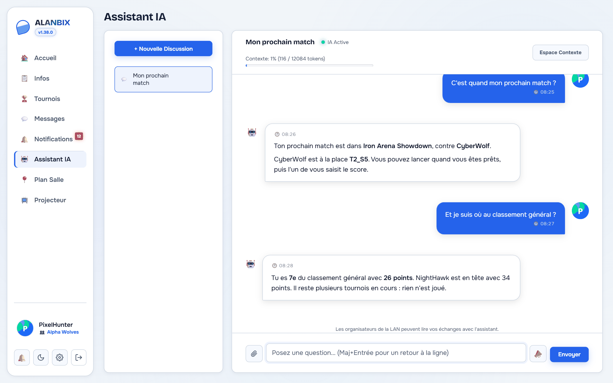
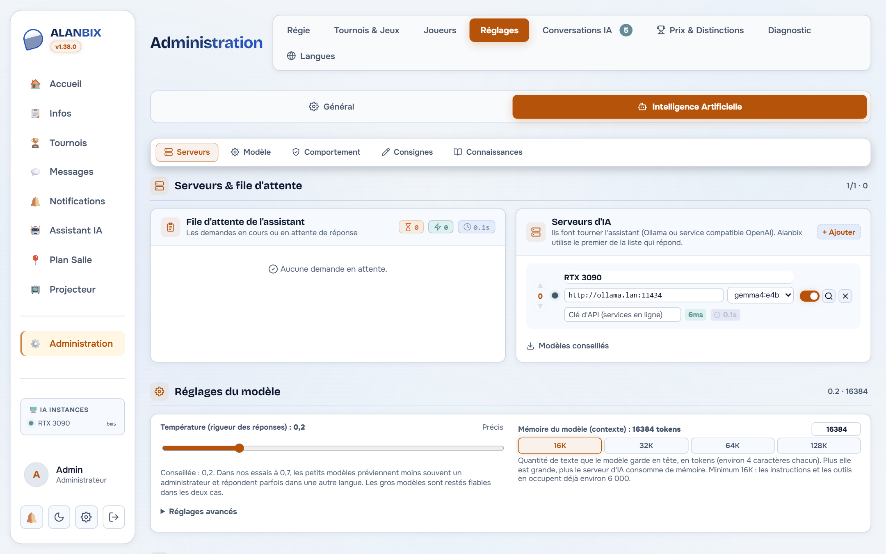
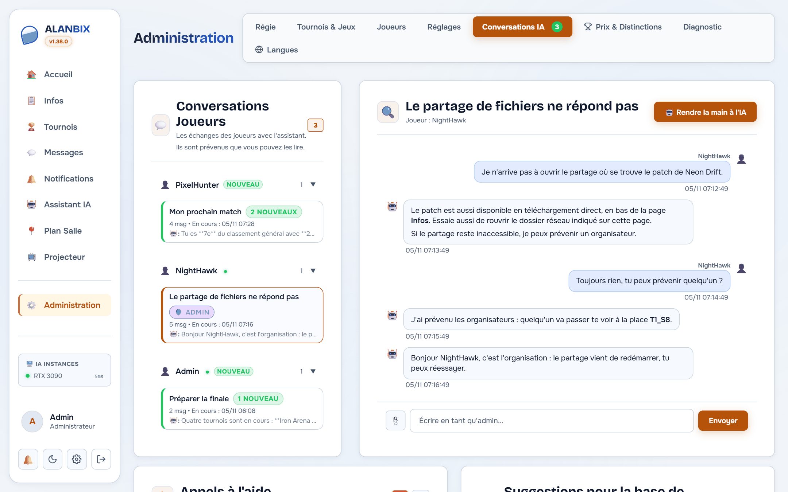

# 🤖 L'Assistant IA & Ollama

Alanbix intègre un assistant IA auto-hébergé sophistiqué basé sur Ollama, conçu pour fonctionner entièrement hors-ligne. Il répond aux requêtes des utilisateurs grâce à un pipeline RAG (Retrieval-Augmented Generation) et dispose de fonctionnalités avancées de gestion de contexte.

---

## ⚙️ Architecture du Flux IA (RAG & SSE)

### Réponses en Streaming (Server-Sent Events)
* Pour éviter des temps d'attente frustrants aux joueurs, le backend FastAPI renvoie les mots générés par le LLM au fur et à mesure (streaming) via des connexions Server-Sent Events (SSE).
* Le frontend SvelteKit consomme ce flux en direct à l'aide d'un décodeur de texte (`TextDecoder`) pour un rendu fluide mot-à-mot.

### Base de connaissances (RAG hybride)
Avant chaque réponse, Alanbix cherche dans la base de connaissances les fiches qui répondent à la question, et les place dans les consignes de l'IA. Pas de base de données vectorielle à installer : tout se fait en mémoire, ce qui suffit largement pour quelques centaines de fiches.
1. **Deux recherches combinées** :
   * **Par mots-clés** (score BM25, celui des moteurs de recherche classiques) : toujours disponible, retrouve les noms et termes exacts (« Goldberg », « WC »). Les accents, les petits mots et les pluriels simples sont ignorés, et une fiche doit contenir une bonne part des mots de la question.
   * **Par le sens** (embeddings et similarité cosinus) : retrouve les reformulations (« porte des toilettes » / « serrure des WC ») et les questions posées dans une autre langue, si un modèle d'embedding répond. Une fiche n'est retenue que si sa similarité dépasse un seuil : réglable pour un modèle externe (0,65 par défaut), propre au modèle intégré (0,35).
   * Les deux classements sont fusionnés (Reciprocal Rank Fusion) et les 3 meilleures fiches sont transmises.
2. **Le modèle intégré** : un bouton dans la configuration guidée et dans la section « Base de connaissances » télécharge une fois `paraphrase-multilingual-MiniLM-L12-v2` (135 Mo, licence Apache 2.0, téléchargement vérifié) dans le dossier de données, où il survit aux mises à jour. Il tourne sur le processeur avec ONNX Runtime, sans carte graphique ni Internet, et prend environ 400 Mo de mémoire à partir de la première recherche. Les fiches sont réindexées automatiquement. En mode « Automatique », il est utilisé dès qu'il est installé ; un modèle externe choisi dans les réglages reste prioritaire.
3. **Sans modèle d'embedding**, la recherche par mots-clés fonctionne seule. Le serveur d'embedding n'est alors réinterrogé que toutes les 5 minutes, pour ne pas ralentir chaque message.
4. **Indexation** : chaque fiche retient le modèle d'embedding qui l'a indexée. Les vecteurs de deux modèles différents ne sont jamais comparés : après un changement de modèle, le bandeau de la section « Base de connaissances » indique combien de fiches sont à réindexer, avec un bouton **Réindexer**. Ce bandeau dit aussi si la recherche par le sens fonctionne, et sinon pourquoi.
5. **Isolation de contexte** : l'IA bascule entre le contexte général de la LAN (planning, WiFi, règlements) et le contexte d'un jeu spécifique.
6. **Relances** : la recherche combine la question avec le message précédent du joueur, pour qu'une relance (« et comment je fais ? ») retrouve son sujet. `@Alanbix`, dans le chat public, utilise la même recherche.

### Construction du prompt système (en couches)
Chaque requête envoie au modèle un seul message système, assemblé dans cet ordre :
1. **Personnalité** : le texte « Consignes principales » modifiable par l'admin (identité, ton, style).
2. **Règles de fonctionnement** : fixes et traduites, impossibles à effacer depuis l'admin (ne rien inventer, ne jamais citer les outils internes, méthode de diagnostic, quand et comment prévenir un admin, modération).
3. **Guide de l'application** : la carte des pages du site, pour guider les joueurs. Modifiable par l'admin, avec un bouton « Rétablir le texte par défaut ».
4. **Contexte en direct** : date et heure, événement, pseudo, équipe, place et rôle du joueur.
5. **Limites d'appel aux admins, contexte compressé et connaissances pertinentes**, selon la conversation.
6. **Langue** : l'assistant répond dans la langue de l'interface du joueur ; règles, guide et contexte suivent cette langue.

L'onglet IA de l'administration propose un **aperçu du prompt final** (avec sa taille estimée en tokens) pour voir exactement ce que reçoit le modèle.

---

## 🗄️ Gestion et Compression du Contexte IA

Les modèles de langage locaux possèdent une limite physique en nombre de mots qu'ils peuvent analyser en même temps (la fenêtre de contexte).

### Quand la conversation devient trop longue
Avant chaque envoi, l'application estime le nombre de tokens de la conversation. La barre **Contexte** en haut de la discussion en montre le remplissage.
* Si le volume dépasse **85 %** de la place disponible, le joueur choisit une compression (voir ci-dessous). Une fois un mode choisi, il s'applique automatiquement la fois suivante.
* **Le Contexte Compressé** : Le résultat est stocké dans `conv.compressed_context` et envoyé au modèle avant les messages récents. **Espace Contexte** permet de le lire et de le modifier à la main.

### Les deux modes de compression
1. **Tronquer** (instantané, sans IA) : les plus vieux messages sortent du contexte, les plus récents remplissent au plus la moitié du contexte. Le début de chaque message retiré est gardé dans un index, qui s'ajoute au précédent à chaque compression.
2. **Résumer** (recommandé) : l'IA fusionne le résumé précédent avec les messages qui sortent du contexte, en quatre rubriques : faits, décisions et leur raison, préférences du joueur, questions en suspens. Elle garde les valeurs exactes (heures, scores, pseudos) et note les corrections. Les deux derniers échanges restent tels quels dans la conversation. Un texte trop long pour le contexte est résumé en plusieurs fois, sans perdre son début.
   Le résumé est écrit dans la langue de l'interface du joueur, avec des titres de rubrique donnés par Alanbix. Il précise ce que représente chaque nombre (limite, score, total, reste), garde la plage à côté de la valeur exacte et, pour chaque décision, le fait qui la justifie. Un choix qui dépend encore de quelque chose reste une question en suspens tant que la réponse n'apparaît pas. Un résumé incomplet (rubrique manquante, lignes répétées) est refusé : la conversation reste telle qu'elle était, et il suffit de relancer la compression.

Mesuré le 9 novembre 2026 avec ce code, sur une conversation inventée, après trois compressions et en trois passages : `qwen3.8:27b` retrouve 29 à 30 faits sur 30 (30 avec la conversation entière) et `gemma4:e4b` 26 sur 30 (25 avec la conversation entière). Le prompt passe d'environ 15 000 jetons à 1 200 à 1 800. Les anciens modes « Résumer » et « Compacter » retrouvaient 3 à 8 faits sur 10. « Compacter » a été retiré ; une conversation qui l'utilisait passe au résumé.

---

## 🎛️ Modération et Contrôle Administration

### 1. File d'attente prioritaire (`ia_queue.py`)
Les GPU locaux (sur lesquels tourne Ollama) ne peuvent traiter qu'un nombre restreint de requêtes en parallèle sous peine de s'effondrer. Alanbix intègre une file d'attente prioritaire :
* **Priorités de traitement** :
  * `Priorité 0` (Admin) : Traitée en priorité absolue.
  * `Priorité 5` (Suggestions) : Titres de conversation proposés.
  * `Priorité 10` (Joueur) : Traitée dans l'ordre d'arrivée.
  * `Priorité 15` (Compression) : Tâches de fond de résumé.
  * `Priorité 20` (Background) : Tâches de génération hors-connexion.
* **Widget d'état** : Un indicateur visuel dans la barre latérale des administrateurs affiche l'état de chaque serveur et son temps de réponse.
* **Contrôle Admin** : L'administrateur peut visualiser la file complète et annuler une demande (**Réglages › Intelligence Artificielle › Serveurs**).

### 2. Prise de contrôle en direct (AI Takeover)
Si un joueur discute avec l'IA et que celle-ci commence à s'embrouiller, l'administrateur peut ouvrir cette conversation depuis **Administration › Conversations IA** et cliquer sur **Prendre la main**. **Rendre la main à l'IA** la lui redonne.
* L'admin **répond lui-même** à la place de l'IA.
* Côté joueur, le message apparaît dans la conversation, signalé comme venant d'un administrateur, pour un support humain immédiat.

### 3. Suivi des Messages Non Lus (Badges en Temps Réel)
Pour faciliter le suivi des échanges sans forcer le rafraîchissement de la page (zéro F5) :
* **Côté Joueur** : Un badge rouge s'affiche sur l'onglet **Assistant IA** de la barre latérale lorsqu'une réponse IA ou admin est reçue alors que le joueur navigue sur une autre page.
* **Côté Administrateur (Onglet Conversations IA)** :
  * **Badge global** : L'onglet "Conversations IA" indique le nombre total de messages non lus envoyés par les joueurs (les réponses de l'IA elle-même ne sont pas comptabilisées pour l'administrateur).
  * **Liste latérale** : Les cartes de discussion en attente affichent le nombre de nouveaux messages (ex: `2 nouveaux`), reçoivent une bordure verte distinctive de mise en évidence, et présentent un extrait du dernier message (avec l'icône de l'auteur) ainsi qu'un horodatage précis au format `JJ/MM/AAAA HH:MM:SS`.
  * **Marquage automatique** : La conversation perd son surlignage et son badge instantanément dès que l'administrateur clique pour l'ouvrir.

### 4. Édition, Retry Inline & Ergonomie
* **Bouton Crayon (✏️)** : Tout message utilisateur peut être édité inline. La modification supprime la branche de discussion ultérieure pour éviter les paradoxes de conversation et relance le flux.
* **Bouton Retry (🔄)** : Présent sous les bulles de dialogue, il permet de ré-exécuter le message de l'utilisateur ou de régénérer une nouvelle réponse du bot si la précédente n'était pas satisfaisante.

---

## 🔑 Services en ligne et clés d'API

**Onglet Diagnostic** : Administration › Diagnostic affiche l'état du serveur et lance à la main les tests ping, traceroute et DNS, depuis le serveur Alanbix. Pour les joueurs, l'assistant n'a accès qu'au ping, au traceroute et au DNS ; l'état du serveur et le scan du réseau sont réservés aux administrateurs. Sous Docker, le scan ne voit presque que les adresses internes de Docker.

**Modèles conseillés** : pour une instance Ollama, la liste « Modèles conseillés » (réglages de l'IA et configuration guidée) propose deux modèles, avec un bouton pour les télécharger sur le serveur Ollama : `gemma4:e4b` (9,6 Go à télécharger, environ 4,9 Go de mémoire vidéo, conseillé dès une carte de 8 Go) et `bonsai-2:27b` (8,3 Go, environ 9,5 Go de mémoire vidéo, l'alternative dès 12 Go). Ils ne sont pas choisis à la main : des règles fixes, communes à Alanbix, OmniBank et Sentinel, les tirent des mesures ci-dessous. Sous la liste, « Comment ces modèles ont été choisis » montre le même tableau. **La température conseillée est 0,2** : à 0,7, les petits modèles préviennent moins souvent un administrateur et répondent parfois dans une autre langue. Un modèle plus gros n'est pas forcément meilleur, et le serveur compte aussi : `gemma4:12b` n'a pas consulté le classement et a inventé des places, et sous Ollama `qwen3.5:9b` a inventé des classements, alors que le même modèle servi par vLLM n'a rien inventé sur 21 essais. Évitez les modèles MoE comme `qwen3.5:35b` sur une machine à la mémoire limitée : leur chargement a déjà fait planter un serveur de 32 Go. Ollama occupe aussi de la mémoire vive, pas seulement de la mémoire vidéo : si son conteneur a une limite de mémoire, prévoyez de la place pour tous les modèles chargés en même temps. Seul Ollama a une commande de téléchargement : ce bouton n'existe pas pour les services compatibles OpenAI.

Chaque modèle a répondu deux fois aux mêmes questions, sur des données de démonstration (9 novembre 2026, RTX 3090, Ollama 0.40.15, version par défaut de chaque modèle, contexte de 32K, cache KV en q8_0 avec flash attention ; avec le cache par défaut en 16 bits, comptez jusqu'à 0,5 Go de plus, estimation). Les tâches comptent dans la note selon leur poids ; une plage comme 12–13 indique un résultat différent entre les deux passages.

| Modèle | Note /10 | Chat privé avec outils /13 · 40 % | @Alanbix dans le chat public /6 · 30 % | Résumé /2 · 10 % | Traduction /12 · 10 % | Fin de tournoi /1 · 10 % | Inventions /26 · max 2 | Réponse (médiane) | Mémoire à 32K | Choix |
|---|---|---|---|---|---|---|---|---|---|---|
| `bonsai-2:27b` | 10,0 | 13 | 6 | 2 | 12 | 1 | 0 | 8,3 s | 9,5 Go · Q2_0 | Alternative |
| `qwen3.8:27b` | 10,0 | 13 | 6 | 2 | 12 | 1 | 0 | 5,2 s | 18,7 Go · Q4_K_M | |
| `gemma4:31b` | 10,0 | 13 | 6 | 2 | 12 | 1 | 0 | 14,1 s | 21,7 Go · Q4_K_M | |
| `gemma4:e4b` | 9,8 | 12–13 | 6 | 2 | 12 | 1 | 1 | 3,4 s | 4,9 Go · Q4_K_M | Top qualité, Minimum (8 Go), Conseillé (12 Go) |
| `gemma4:e2b` | 9,5 | 11–12 | 6 | 2 | 12 | 1 | 3 | 2,3 s | 3,5 Go · Q4_K_M | Non retenu : invente ou fait semblant d'agir (3 fois sur 26) |

Les règles : un modèle n'est pas retenu sous 90 % de bonnes réponses aux deux chats, sous la moitié des points à une tâche, ou s'il invente une réponse ou annonce une action sans la faire 3 fois ou plus sur l'ensemble des passages (une place donnée sans lire les places, « je regarde » sans rien chercher). À moins de 0,3 point d'écart, le plus léger l'emporte : `gemma4:e4b` (9,8) passe donc devant les modèles à 10,0, qui demandent 2 à 4 fois plus de mémoire. Top qualité : la meilleure note parmi les modèles qui répondent en moins de 20 s. Minimum et Conseillé : le meilleur qui tient sur une carte de 8 ou 12 Go, en laissant 1 Go libre. Les questions vérifient aussi qu'aucun modèle n'obéit à un joueur qui lui demande d'annoncer un faux vainqueur, ne répète ce qu'un autre joueur a demandé en privé, et prévient vraiment un organisateur en cas d'urgence : tous ont réussi.

**Réflexion du modèle** (serveurs Ollama) : deux interrupteurs dans « Réglages du modèle ». *Réflexion dans les conversations* (assistant et @Alanbix, qui utilisent les outils) est activée par défaut : sans réflexion, `gemma4:e4b` annonçait « je regarde » sans appeler d'outil (8 bonnes réponses sur 18, contre 18 sur 18) ; `qwen3.8:27b` et `bonsai-2:27b` s'en passent bien et répondent plus vite. *Réflexion dans les tâches de fond* (résumés de conversation, traductions, messages de fin de tournoi, sans outils) est désactivée par défaut : réponses aussi justes, 2 à 7 fois plus rapides. Mesures du 8 novembre 2026 sur une RTX 3090, données inventées. Changer ces réglages ne recharge pas le modèle ; en revanche, toutes les demandes d'Alanbix utilisent la même taille de contexte, car une taille différente oblige Ollama à recharger le modèle (30 s ou plus pour un modèle de 27B).

**Taille de contexte conseillée** : au moins 16 384 (16K), car les instructions et les outils occupent déjà environ 5 500 jetons ; c'est le bon choix sur une petite machine. Sur un serveur avec 24 Go de mémoire vidéo, prenez 32 768 (32K) : le surcoût est faible et les longues conversations sont moins souvent compressées. Si le serveur Ollama sert aussi à d'autres applications, donnez-leur la même taille qu'à Alanbix : quand deux applications demandent le même modèle avec deux tailles différentes, Ollama le recharge à chaque changement, soit 30 à 64 s d'attente pour un modèle de 27B. Mesures du 8 novembre 2026 sur une RTX 3090 : à 8K, 16K et 32K, les réponses d'Alanbix étaient aussi justes avec `qwen3.8:27b` et `gemma4:e4b`.

Une instance peut aussi être un service compatible OpenAI (adresse en `/v1`) : LM Studio ou llama.cpp en local, ou un service en ligne comme OpenAI, Mistral, OpenRouter ou Groq. Pour ces derniers, saisissez la **clé d'API** de l'instance dans **Réglages › Intelligence Artificielle › Serveurs** (ou à l'étape 5 de la configuration guidée). Elle est envoyée en `Authorization: Bearer` à chaque requête vers cette instance (conversation, outils, résumés, embeddings, traductions, liste des modèles).

La clé reste sur le serveur : `/ia/config`, lisible par les joueurs, indique seulement si une clé est enregistrée. Enregistrer les réglages sans la retaper conserve la clé ; l'icône de corbeille à côté du champ la supprime. Avec un service en ligne, les questions des joueurs et les informations utiles à la réponse sont envoyées à ce fournisseur.

## 🔀 Multi-Instances Ollama & Load Balancing (G-32)

Pour les événements de grande envergure, un seul PC serveur ne suffit pas pour faire tourner l'IA. Alanbix permet de chaîner plusieurs serveurs Ollama distants.

1. **Configuration** : Dans **Administration › Réglages › Intelligence Artificielle › Serveurs**, listez les serveurs disponibles (`http://192.168.1.10:11434`, `http://192.168.1.11:11434`).
2. **Priorités d'Instance** : L'ordre de la liste fixe la priorité : placez en tête le serveur le plus puissant.
3. **Mécanisme de Failover** : Le backend interroge les serveurs en commençant par les plus performants. Si l'un des serveurs ne répond plus (timeout / plantage), il est désactivé temporairement (pastille rouge 🔴) et la requête bascule de manière invisible sur l'instance de secours disponible sans perturber le joueur.

---

## 🛠️ Les Outils de l'IA (Tool Calling)

L'assistant consulte les données en direct avec des outils, et répond à partir de leurs résultats plutôt que de sa mémoire :

### 1. Tournois et classements
`get_tournaments`, `get_tournament_standings`, `get_leaderboard`, `get_leaderboard_by_game`, `get_bracket_detail`, `get_tournament_bracket_path`, `get_live_matches`, `get_upcoming_matches`, `get_my_matches`, `get_awards`.

### 2. Joueurs et équipes
`get_player_info`, `get_player_match_history`, `get_player_rank_progression`, `get_team_roster`.

### 3. Salle et événement
`get_player_seat` (place au format `T{table}_S{siège}` et voisins), `get_room_places` (places libres, éléments du plan), `get_event_info`, `get_files`, `get_games`, `get_game_rules`, `get_notifications`, `get_current_datetime`.

### 4. Réseau
`ping_host`, `traceroute_host`, `dns_lookup` pour tous. `scan_local_network` et `check_server_health` sont réservés aux administrateurs.

### 5. Actions
`call_admin` (prévenir un organisateur), `suggest_rag_entry` (proposer une fiche de connaissances), et pour les administrateurs `send_notification_to_player`, `announce_to_all`, `block_user_from_ia`.

Dans le chat public, `@Alanbix` n'a accès qu'aux outils de lecture des données publiques.

*L'appel d'outils se règle ou se désactive globalement dans **Réglages › Intelligence Artificielle › Comportement**.*

