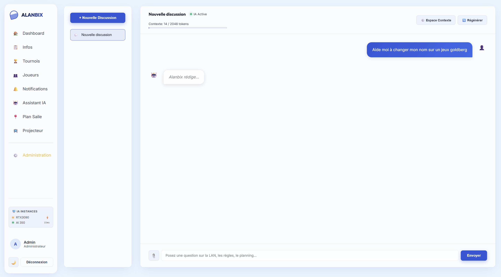
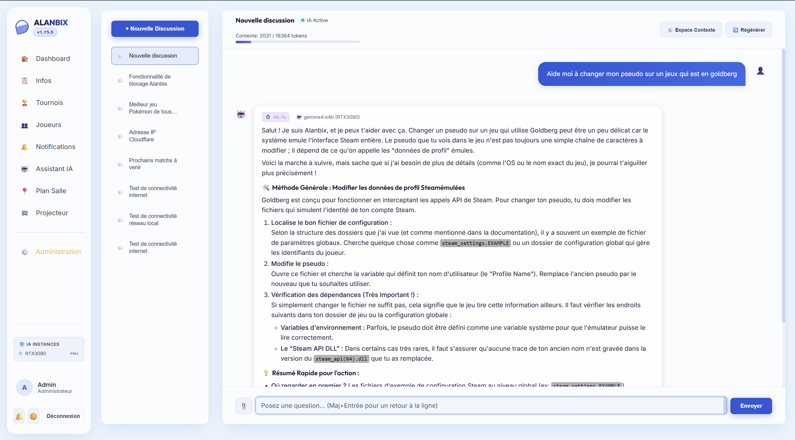
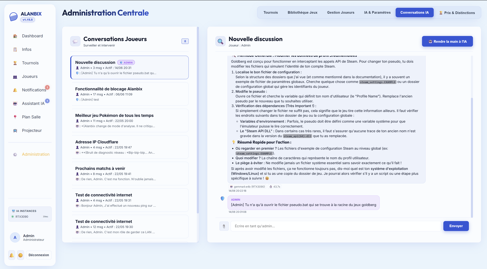

# 🤖 L'Assistant IA & Ollama

Alanbix intègre un assistant IA auto-hébergé sophistiqué basé sur Ollama, conçu pour fonctionner entièrement hors-ligne. Il répond aux requêtes des utilisateurs grâce à un pipeline RAG (Retrieval-Augmented Generation) et dispose de fonctionnalités avancées de gestion de contexte.

---

## ⚙️ Architecture du Flux IA (RAG & SSE)

### Réponses en Streaming (Server-Sent Events)
* Pour éviter des temps d'attente frustrants aux joueurs, le backend FastAPI renvoie les mots générés par le LLM au fur et à mesure (streaming) via des connexions Server-Sent Events (SSE).
* Le frontend SvelteKit consomme ce flux en direct à l'aide d'un décodeur de texte (`TextDecoder`) pour un rendu fluide mot-à-mot.

### Moteur de RAG Native (Calcul NumPy)
Afin d'éviter l'infrastructure complexe d'une base de données vectorielle dédiée (comme pgvector/PostgreSQL), Alanbix embarque un moteur RAG matriciel codé en Python natif avec NumPy :
1. **Indexation** : Les documents téléchargés par les administrateurs sont découpés et leurs embeddings (représentations vectorielles) sont calculés via Ollama puis stockés en format JSON dans la base SQLite.
2. **Recherche Vectorielle** : À chaque question posée par un utilisateur, le backend charge les embeddings de la base SQLite et effectue un calcul de **Similarité Cosinus (Cosine Similarity)** en mémoire vive via NumPy.
3. **Isolation de contexte** : L'IA bascule intelligemment entre le contexte général de la LAN (planning, WiFi, règlements) et le contexte d'un jeu spécifique pour optimiser la qualité des réponses.
4. **Seuil de pertinence** : une fiche n'est transmise à l'IA que si sa similarité dépasse un seuil réglable (0,65 par défaut, dans la configuration du modèle). La recherche combine la question avec le message précédent du joueur, pour qu'une relance (« et comment je fais ? ») retrouve son sujet.

### Construction du prompt système (en couches)
Chaque requête envoie au modèle un seul message système, assemblé dans cet ordre :
1. **Personnalité** : le texte « Consignes principales » modifiable par l'admin (identité, ton, style).
2. **Règles de fonctionnement** : fixes et traduites, impossibles à effacer depuis l'admin (ne rien inventer, ne jamais citer les outils internes, méthode de diagnostic, quand et comment prévenir un admin, modération).
3. **Guide de l'application** : la carte des pages du site, pour guider les joueurs. Modifiable par l'admin, avec un bouton « Rétablir le texte par défaut ».
4. **Contexte en direct** : date et heure, événement, pseudo, équipe, place et rôle du joueur.
5. **Limites d'appel aux admins, contexte compressé et connaissances pertinentes**, selon la conversation.
6. **Langue** : l'assistant répond dans la langue de l'interface du joueur ; règles, guide et contexte suivent cette langue.

L'onglet IA de l'administration propose un **aperçu du prompt final** (avec sa taille estimée en tokens) pour voir exactement ce que reçoit le modèle.

---

## 🗄️ Gestion et Compression du Contexte IA

Les modèles de langage locaux possèdent une limite physique en nombre de mots qu'ils peuvent analyser en même temps (la fenêtre de contexte).

### Le Mécanisme d'Auto-Compression (G-40)
Avant chaque requête, le backend estime le nombre de tokens de la conversation (règle empirique : 1 mot = ~1.3 tokens).
* Si le volume de tokens dépasse **90%** de la taille de fenêtre du modèle (ex: 4096 tokens) : Le serveur déclenche une compression automatique.
* **Stratégie** : Il tronque 50% de l'historique de discussion, conserve les messages clés, et demande au LLM d'en générer un résumé compact sous forme de paragraphe.
* **Le Contexte Compressé** : Ce paragraphe est alors stocké dans `conv.compressed_context` et placé tout en haut de la conversation avec une icône de boîte d'archive (🗄️).
* **Édition Libre** : L'utilisateur peut cliquer sur le bouton Crayon (✏️) au niveau du contexte compressé pour modifier le résumé manuellement afin d'ajuster ce que l'IA doit "se rappeler" pour la suite de la discussion.

### Le Modal Utilisateur (G-43)
Lorsque le volume atteint **85%** de la limite, le joueur se voit proposer un modal de choix de compression :
1. **Tronquer** : Supprime simplement les plus vieux messages (rapide).
2. **Compacter** : Fusionne les messages redondants ou salutations (moyen).
3. **Résumer** : Génère un résumé global (meilleure rétention d'information).

---

## 🎛️ Modération et Contrôle Administration

### 1. File d'attente prioritaire (`ia_queue.py`)
Les GPU locaux (sur lesquels tourne Ollama) ne peuvent traiter qu'un nombre restreint de requêtes en parallèle sous peine de s'effondrer. Alanbix intègre une file d'attente prioritaire :
* **Priorités de traitement** :
  * `Priorité 0` (Admin) : Traitée en priorité absolue.
  * `Priorité 10` (Joueur) : Traitée dans l'ordre d'arrivée.
  * `Priorité 15` (Compression) : Tâches de fond de résumé.
  * `Priorité 20` (Background) : Tâches de génération hors-connexion.
* **Widget d'état** : Un indicateur visuel dans la barre latérale affiche la charge (En attente, Temps de réponse estimé basé sur une moyenne des 20 dernières requêtes).
* **Contrôle Admin** : L'administrateur peut visualiser la file complète, réordonner les requêtes ou annuler des générations suspectes de bloquer le serveur.

### 2. Prise de contrôle en direct (AI Takeover)
Si un joueur discute avec l'IA et que celle-ci commence à s'embrouiller, l'administrateur système peut ouvrir cette conversation depuis son interface de modération.
* L'admin peut **saisir une réponse manuellement** à la place de l'IA.
* Côté joueur, le message apparaît sous forme de message système distinct : *"L'administrateur a pris le contrôle de cette réponse"*, pour un support technique humain immédiat.

### 3. Suivi des Messages Non Lus (Badges en Temps Réel)
Pour faciliter le suivi des échanges sans forcer le rafraîchissement de la page (zéro F5) :
* **Côté Joueur** : Un badge rouge s'affiche sur l'onglet **Assistant IA** de la barre latérale lorsqu'une réponse IA ou admin est reçue alors que le joueur navigue sur une autre page.
* **Côté Administrateur (Onglet Conversations IA)** :
  * **Badge global** : L'onglet "Conversations IA" indique le nombre total de messages non lus envoyés par les joueurs (les réponses de l'IA elle-même ne sont pas comptabilisées pour l'administrateur).
  * **Liste latérale** : Les cartes de discussion en attente affichent le nombre de nouveaux messages (ex: `2 nouveaux`), reçoivent une bordure verte distinctive de mise en évidence, et présentent un extrait du dernier message (avec l'icône de l'auteur) ainsi qu'un horodatage précis au format `JJ/MM/AAAA HH:MM:SS`.
  * **Marquage automatique** : La conversation perd son surlignage et son badge instantanément dès que l'administrateur clique pour l'ouvrir.

### 4. Édition, Retry Inline & Ergonomie
* **Redimensionnement du Chat** : Les utilisateurs disposent d'une barre de redimensionnement pour élargir le panneau de discussion jusqu'à **70%** de la largeur de l'écran. L'ajustement de la largeur est sauvegardé de manière persistante.
* **Bouton Crayon (✏️)** : Tout message utilisateur peut être édité inline. La modification supprime la branche de discussion ultérieure pour éviter les paradoxes de conversation et relance le flux.
* **Bouton Retry (🔄)** : Présent sous les bulles de dialogue, il permet de ré-exécuter le message de l'utilisateur ou de régénérer une nouvelle réponse du bot si la précédente n'était pas satisfaisante.

---

## 🔑 Services en ligne et clés d'API

Une instance peut aussi être un service compatible OpenAI (adresse en `/v1`) : LM Studio ou llama.cpp en local, ou un service en ligne comme OpenAI, Mistral, OpenRouter ou Groq. Pour ces derniers, saisissez la **clé d'API** de l'instance dans **Réglages › Intelligence Artificielle › Serveurs** (ou à l'étape 5 de la configuration guidée). Elle est envoyée en `Authorization: Bearer` à chaque requête vers cette instance (conversation, outils, résumés, embeddings, traductions, liste des modèles).

La clé reste sur le serveur : `/ia/config`, lisible par les joueurs, indique seulement si une clé est enregistrée. Enregistrer les réglages sans la retaper conserve la clé ; l'icône de corbeille à côté du champ la supprime. Avec un service en ligne, les questions des joueurs et les informations utiles à la réponse sont envoyées à ce fournisseur.

## 🔀 Multi-Instances Ollama & Load Balancing (G-32)

Pour les événements de grande envergure, un seul PC serveur ne suffit pas pour faire tourner l'IA. Alanbix permet de chaîner plusieurs serveurs Ollama distants.

1. **Configuration** : Dans **Administration > Paramètres IA**, listez les serveurs disponibles (`http://192.168.1.10:11434`, `http://192.168.1.11:11434`).
2. **Priorités d'Instance** : Attribuez une priorité numérique à chaque serveur (ex: 0 pour un serveur avec RTX 4090, 10 pour un petit laptop).
3. **Mécanisme de Failover** : Le backend interroge les serveurs en commençant par les plus performants. Si l'un des serveurs ne répond plus (timeout / plantage), il est désactivé temporairement (pastille rouge 🔴) et la requête bascule de manière invisible sur l'instance de secours disponible sans perturber le joueur.

---

## 🛠️ Les Outils de l'IA (Tool Calling)

L'assistant IA d'Alanbix dispose de capacités d'appel d'outils (tool calling) lui permettant d'interagir dynamiquement avec le système et d'effectuer des tâches utiles pour les joueurs et les organisateurs :

### 1. Localisation et plan de salle
* `get_player_seat` : Permet à l'IA de retrouver le siège assigné à un joueur (format `T{table}_S{siège}`) et d'identifier ses voisins directs de table.

### 2. Diagnostics Réseau et Logistique
* `ping_host` : Permet à l'IA de tester la connectivité réseau vers une machine.
* `traceroute_host` : Permet de diagnostiquer les chemins réseau.
* `dns_lookup` : Effectue des résolutions d'adresses IP/noms d'hôtes.
* `scan_local_network` : Scanne le sous-réseau local pour détecter les ports et services actifs.
* `check_server_health` : Retourne l'état de santé global du serveur Alanbix.

### 3. Informations sur les Jeux
* `get_game_rules` : Récupère la fiche descriptive et les règles d'un jeu configuré dans la bibliothèque.

*Ces outils peuvent être activés ou désactivés globalement par l'administrateur depuis les options d'administration de l'IA.*

