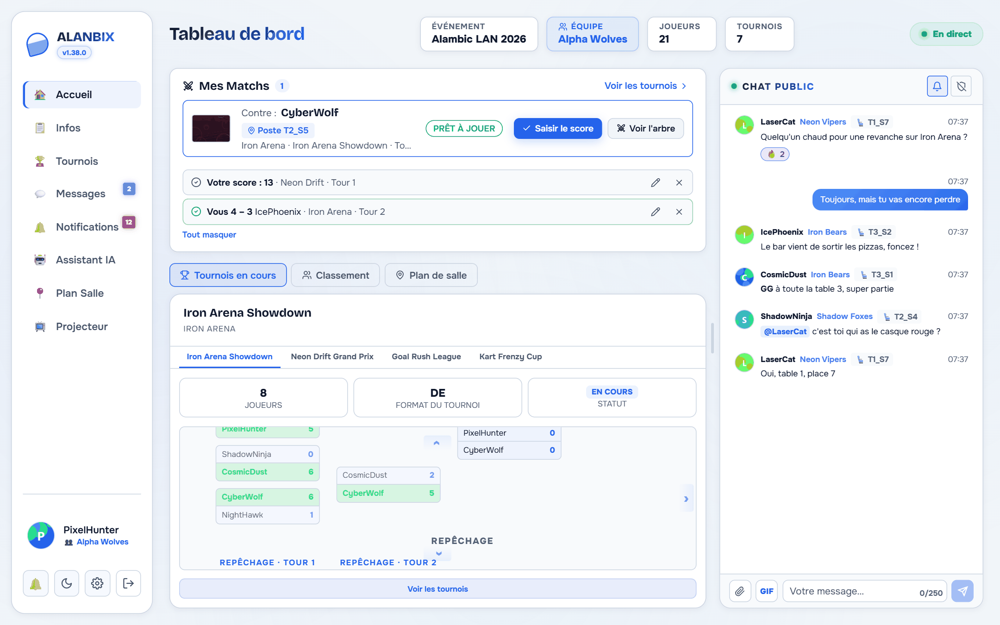

# 🚀 Guide de Démarrage Rapide

Ce guide vous aide à installer et configurer Alanbix pour la première fois pour votre événement.

---

## 💾 Prérequis
* **Docker & Docker Compose** installés sur votre serveur de LAN.
* **Ollama ou endpoint compatible OpenAI (LocalAI, etc.)** (facultatif mais recommandé pour l'IA) en cours d'exécution locale ou sur le réseau.

---

## 🛠️ Étape 1 : Déploiement

Alanbix peut être installé de trois manières différentes selon vos besoins de production et de développement.

### Option A : Depuis Docker Hub (Recommandé pour la Production)
Pour un déploiement rapide et stable en production sans compiler le code, utilisez le fichier officiel `docker-compose.prod.yml` (inclut Alanbix standalone et SearXNG préconfigurés) :

```bash
docker compose -f docker-compose.prod.yml up -d
```

Ou directement via `docker run` :
```bash
docker run -d \
  -p 41481:41481 \
  -v alanbix_data:/app/data \
  --name alanbix \
  aschefr/alanbix:latest
```

* L'application tourne sur le port unique `41481` (qui sert à la fois le frontend et le backend).
* Les données de la base SQLite et des téléversements de fichiers sont conservées dans le volume `alanbix_data`.
* **Clé secrète des connexions** : au premier démarrage, Alanbix génère une clé aléatoire unique et la conserve dans le volume (`/app/data/.secret_key`). Conservez ce volume : s'il est perdu, tout le monde devra simplement se reconnecter. Pour fournir votre propre clé, définissez la variable d'environnement `SECRET_KEY`.
* **Accès depuis d'autres sites (CORS)** : par défaut, seuls la machine elle-même, l'application mobile, le réseau local et Tailscale sont autorisés. Pour une autre adresse (nom de domaine, reverse proxy…), définissez `CORS_ORIGINS` (liste séparée par des virgules, ou `*` pour tout autoriser).
* **Compte utilisé dans le conteneur** : depuis la version 1.37, l'application ne tourne plus en administrateur (root) mais avec un compte ordinaire, `1000:1000` par défaut. Au démarrage, le dossier de données lui est confié automatiquement, y compris celui d'une ancienne installation. Pour un autre compte, définissez `PUID` et `PGID` (sur Unraid : `PUID=99` et `PGID=100`).

#### 🔍 (Optionnel) Déployer SearXNG pour la recherche de jaquettes
Si vous utilisez le déploiement Docker Hub (Option A) et souhaitez bénéficier de la recherche automatique de jaquettes de jeux, vous devez lancer une instance SearXNG à côté :
1. Créez un fichier `settings.yml` en activant le format de sortie JSON (requis par le backend) :
   ```yaml
   use_default_settings: true
   server:
     secret_key: "remplacez_ceci_par_une_cle_securisee_aleatoire"
   search:
     formats:
       - html
       - json
   ```
2. Lancez le conteneur SearXNG :
   ```bash
   docker run -d \
     -p 8888:8080 \
     -v /chemin/vers/votre/settings.yml:/etc/searxng/settings.yml \
     --name alanbix_searxng \
     searxng/searxng:latest
   ```
3. Dans **Administration › Réglages › Général › Services**, renseignez l'URL de votre API SearXNG (ex: `http://<IP_DE_VOTRE_SERVEUR>:8888`), puis cliquez sur **Tester la connexion**.

---

### Option B : Clonage du Dépôt (Pour le Développement et la modification du code)
Si vous souhaitez modifier le code ou exécuter le projet en local avec le rechargement automatique (HMR) :

1. Clonez le dépôt git :
   ```bash
   git clone https://github.com/Aschefr/Alanbix.git
   cd Alanbix
   ```
2. **(Optionnel - Pour l'accès réseau LAN)** : pour y accéder depuis d'autres appareils de votre réseau local, indiquez aux navigateurs où trouver l'API :
   * Copiez le fichier de configuration d'exemple :
     ```bash
     cp .env.example .env
     ```
   * Ajoutez dans `.env` l'adresse de votre machine hôte : `VITE_API_URL=http://192.168.1.50:8000`.
3. Lancez les conteneurs :
   ```bash
   docker compose up -d --build
   ```
4. L'application est alors accessible sur :
   * **Interface Web (Frontend)** : `http://localhost:41481` (ou `http://<IP_DE_VOTRE_PC>:41481` depuis le LAN)
   * **Documentation de l'API (Backend)** : `http://localhost:8000/docs`

---

### Option C : Sur Unraid (Community Applications / Modèle XML)
Alanbix est disponible dans le store **Community Applications** d'Unraid :

1. Ouvrez l'onglet **Apps** de votre interface Unraid et cherchez **Alanbix**.
2. Cliquez sur **Install**, vérifiez le port et le dossier `appdata`, puis cliquez sur **Apply**.

*(Sans le store)* : copiez le modèle [`alanbix.xml`](https://github.com/Aschefr/unraid-templates/blob/master/alanbix.xml) du dépôt `Aschefr/unraid-templates` dans `/boot/config/plugins/dockerMan/templates-user/` sur votre clé USB Unraid, puis choisissez **Add Container > User Templates > Alanbix**.

#### 🔍 (Optionnel) Configurer SearXNG sur Unraid
Si vous hébergez Alanbix sur Unraid et souhaitez activer la recherche automatique de jaquettes :
1. Allez dans l'onglet **Apps** (Community Applications) d'Unraid, recherchez **SearXNG** et installez-le.
2. Éditez le fichier de configuration de SearXNG dans votre dossier appdata d'Unraid :
   Généralement accessible sur le partage à `/mnt/user/appdata/searxng/settings.yml`.
3. Assurez-vous d'activer le format JSON en ajoutant `json` aux formats de recherche :
   ```yaml
   search:
     formats:
       - html
       - json
   ```
4. Redémarrez le conteneur SearXNG depuis l'interface Unraid.
5. Dans **Administration › Réglages › Général › Services**, renseignez l'URL de votre API SearXNG (ex : `http://<IP_DE_VOTRE_UNRAID>:<PORT_SEARXNG>`).

---

---

## 👑 Étape 2 : Créer le Compte Administrateur

Alanbix attribue automatiquement les droits d'administration globale au **premier utilisateur créé** sur l'application.

1. Rendez-vous sur `http://localhost:41481`.
2. Cliquez sur **S'inscrire** (Register).
3. Remplissez le formulaire (nom d'utilisateur et mot de passe).
4. Vous arrivez sur la **configuration guidée du serveur** : nom de la LAN et langue, Wi-Fi et adresse des joueurs, page Infos (modèle prérempli), jeux et premier tournoi (avec le barème de points et sa simulation), assistant IA (local ou service en ligne avec clé d'API), base de connaissances (modèle de recherche intégré à installer, premières fiches), plan de salle, puis invitation des joueurs (adresse, QR code et affiche à imprimer). Chaque étape peut être passée ; la configuration se reprend depuis l'administration (**Réglages › Général › Configuration guidée**).
5. L'onglet **Administration** apparaît ensuite dans votre menu latéral gauche.

**Se connecter ensuite** : saisissez le pseudo, **Suivant**, puis le mot de passe (l'icône en forme d'œil l'affiche). Une session dure 3 jours et se renouvelle à l'usage ; quand elle se termine, l'application revient à l'écran de connexion.



---

## ⚙️ Étape 3 : Configuration Globale

Allez dans **Administration › Réglages**. Les modifications y sont enregistrées automatiquement :

* **Nom de la LAN** : Personnalisez l'en-tête de l'application (ex: *Retro LAN 2026*).
* **Mode de Calcul d'Équipe** :
  * *Raw (Brut)* : Somme totale des points.
  * *Weighted (Pondéré)* : Somme divisée par la taille de l'équipe (évite de pénaliser les petites équipes).
* **Consignes de l'assistant** (**Réglages › Intelligence Artificielle › Consignes**) : Personnalisez la personnalité de l'IA (ex: *"Tu es le commentateur officiel d'une LAN party fun"*).

---

## 🎮 Étape 4 : Jeux, Plan de Salle & IA

Pour que les fonctionnalités soient exploitables, l'administrateur doit préparer l'environnement :

1. **Ajout de Jeux** : Dans **Administration › Tournois & Jeux**, section **Bibliothèque**, cliquez sur **Ajouter un Jeu**. Utilisez la recherche SearXNG intégrée pour télécharger automatiquement les jaquettes de jeux directement sur votre serveur pour l'offline-first.
2. **Dessin de la Salle** : Ouvrez la page **Plan Salle**, puis **Éditer** : ajoutez les tables (avec leurs sièges) et les éléments (porte, bar, toilettes, borne Wi-Fi…), déplacez-les, puis **Sauvegarder**. Les joueurs pourront ensuite cliquer sur ces sièges pour réserver leur emplacement physique dans la pièce.
3. **Activation de l'IA** : Dans **Administration › Réglages › Intelligence Artificielle › Serveurs**, ajoutez l'URL de votre instance Ollama ou compatible OpenAI (ex : `http://192.168.1.100:11434` pour Ollama, ou `http://192.168.1.100:8080/v1` pour OpenAI/LocalAI), assignez-lui un modèle et vérifiez son statut.

---

## 🏆 Étape 5 : Lancement du Premier Tournoi

1. Allez dans **Administration › Tournois & Jeux**, bloc **Créer un tournoi**.
2. Suivez le wizard en 3 étapes :
   * **Général** : Nommez le tournoi, associez le jeu pré-configuré.
   * **Format** : Choisissez si c'est individuel ou en équipe (et définissez la taille de l'équipe).
   * **Déroulement et points** : Choisissez le format (ex: *Double Élimination*) et configurez les points attribués.
3. Le tournoi créé apparaît alors au statut **OPEN** (Ouvert). Vos joueurs peuvent s'y inscrire depuis la page **Tournois** !

---

Prochaine étape : Consultez le guide sur le **[Moteur de Tournois](features/tournaments.md)** pour apprendre à piloter et clôturer le bracket.
